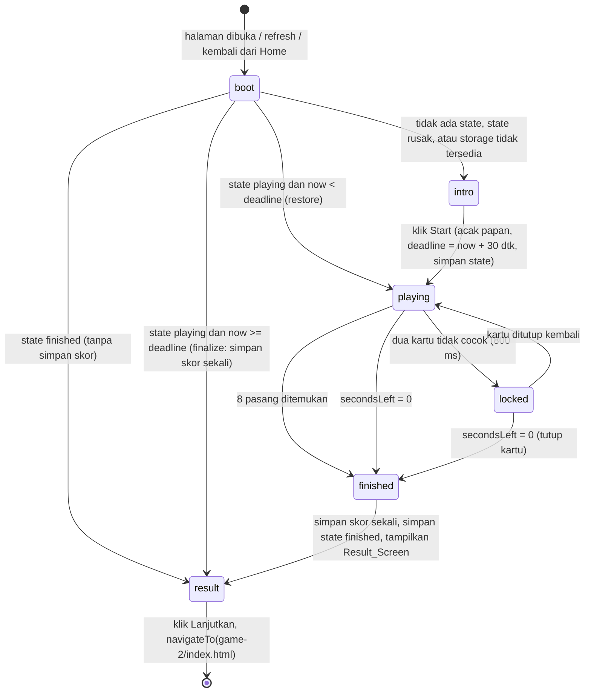
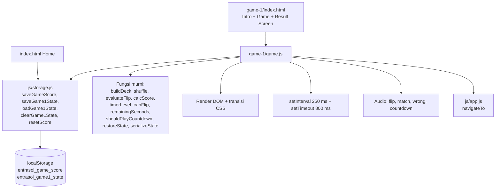

# Dokumen Desain: Memory Flip Game

## Overview

Memory Flip adalah game pertama dari rangkaian tiga mini-game Entrasol. Halaman `game-1/index.html` berisi **tiga tampilan dalam satu file**, dan hanya satu yang terlihat pada satu waktu:

- **Intro_Screen** (`#introScreen`): teks "GAME 01", ikon game, judul, sub judul, box petunjuk berisi alert waktu 30 detik, tombol Start.
- **Game_Screen** (`#gameScreen`): judul terlihat "Memory Flip", timer, skor berjalan, progress bar, papan kartu 4×4.
- **Result_Screen** (`#resultScreen`): judul "Memory Flip", skor besar dengan keterangan "point" dan "dari 40", tombol "Lanjutkan".

Pemain mencari 8 pasang gambar identik dalam 30 detik. Tiap pasangan bernilai 5 point (maks 40). Saat game berakhir (8 pasang ditemukan atau waktu habis), skor ditulis ke LocalStorage lewat `js/storage.js` tepat satu kali, lalu Result_Screen ditampilkan di halaman yang sama. Tidak ada ringkasan 2 detik dan tidak ada navigasi otomatis: pindah ke `game-2/index.html` hanya terjadi saat pemain menekan "Lanjutkan".

Revisi ini menambahkan dua kemampuan:

1. **Efek suara (Audio_Cue)** untuk flip, cocok, tidak cocok, dan hitung mundur 3 detik terakhir.
2. **Persistensi sesi**: Game_Session_State disimpan di key `entrasol_game1_state`. Refresh atau tombol back tidak mengulang permainan. Permainan berjalan dilanjutkan dengan sisa waktu nyata (berbasis Deadline absolut), dan permainan selesai langsung menampilkan Result_Screen. Karena perpindahan tampilan tidak memakai `history.pushState`, tombol back browser dari game-1 selalu kembali ke Home.

Tampilan memakai container mobile maks 430px dengan latar gradasi putih ke biru muda dan wave di bawah, sedangkan latar `body` biru tua transparan hanya berlaku di halaman game-1 (kelas `flip-body`). Teks utama berwarna Biru_Tua `#141A8C`. Home hanya berubah perilaku tombol "Mulai Permainan" (memuat `js/storage.js`, tanpa akses localStorage langsung); tampilannya tidak berubah.

### Keputusan Desain Utama

| Keputusan | Alasan |
|-----------|--------|
| Logika dibagi menjadi **fungsi murni** (acak papan, evaluasi pasangan, skor, format timer, `remainingSeconds`, `shouldPlayCountdown`, `restoreState`, `serializeState`) dan **lapisan DOM/timer/audio** yang tipis | Fungsi murni mudah diuji, termasuk dengan property-based testing, tanpa DOM |
| State game berupa satu objek `state` dengan *phase* eksplisit (`intro`, `playing`, `locked`, `finished`) | Aturan "abaikan sentuhan" (Req 3.1, 5.4, 5.7, 6.6) menjadi satu pengecekan |
| **Deadline absolut** (`Date.now() + 30000` saat Start) disimpan di state, sisa waktu dihitung ulang dari `Date.now()` | Refresh tidak mengatur ulang timer dan waktu selama halaman tertutup tetap terhitung (Req 10.6). Hitung mundur tidak melenceng seperti pengurangan per tick |
| Interval ~250 ms yang menghitung ulang `secondsLeft` dan merender hanya saat nilainya berubah | Tampilan tetap tepat pada detik pergantian walau interval tertahan, tanpa render berlebihan |
| State sesi disimpan di **key terpisah** `entrasol_game1_state`, bukan di dalam `entrasol_game_score` | Skema skor (`memoryFlip`, `memoryRecall`, `memorize`, `total`) tetap sesuai aturan workspace dan tidak tercampur data sementara |
| Result_Screen berada di **halaman yang sama**, tampilan diganti lewat atribut `hidden`, **tanpa `pushState`** | Tombol back kembali ke Home (Req 11.1, 10.10), bukan ke tampilan sebelumnya di halaman yang sama |
| Sesi dipulihkan saat boot lewat `restoreState(loadGame1State(), Date.now())` yang murni | Cabang intro/playing/result dapat diuji tanpa DOM (Req 10.4, 10.8, 10.9, 10.15) |
| `finishGame` dijaga flag `finished` dan hanya dipanggil sekali per sesi; saat reload dengan fase `finished` skor tidak disimpan lagi | Menjamin skor tersimpan tepat sekali per sesi (Req 7.7, 10.16) |
| Audio memakai `new Audio('assets/audio/<nama>.mp3')` dengan `playSound` yang tidak pernah melempar | Autoplay diblokir atau berkas gagal dimuat tidak boleh mengganggu permainan (Req 9.8) |
| Countdown dipicu saat sisa waktu melintasi 3 detik | Aset `countdown.mp3` berdurasi sekitar 3 detik, sehingga selesai tepat saat waktu habis (Req 9.4) |
| Sesi yang dipulihkan dengan sisa waktu ≤ 3 detik tidak memutar countdown (flag `countdownPlayed = true` saat restore) | Mencegah suara muncul tiba-tiba setelah refresh (Req 9.6) |
| Kartu yang terbuka tetapi belum cocok saat restore dikembalikan tertutup | Hanya status `closed`/`matched` yang disimpan; menghindari kartu terbuka tanpa timeout penutup (Req 10.7) |
| Flip kartu memakai CSS 3D transform + transisi 300 ms | Sesuai Req 4.9 (200–400 ms), tanpa library |
| Ukuran kartu dari `grid` + `aspect-ratio: 1 / 1`, maksimum 100px | Persegi dan proporsional di semua lebar (Req 4.4–4.6, 8.2) |
| Memakai `css/style.css` yang sama dengan Home, dengan prefix `flip-` dan `body.flip-body` | Halaman game-1 punya identitas visual sendiri tanpa mengubah Home (Req 2.5, 2.6, 2.8) |
| Time_Alert berada di dalam Instruction_Box | Waktu bermain menjadi bagian petunjuk; bentuk persegi membulat 0.5rem membedakannya dari tombol pill (Req 1.6, 1.7, 2.3) |
| Next_Game_Page = `game-2/index.html` | Mengikuti penamaan folder aktual `game-1` |

### Catatan Riset

Tidak ada kebutuhan riset eksternal. Desain memakai API browser standar (`localStorage`, `Date.now`, `setInterval`/`setTimeout`, `Audio`, CSS `aspect-ratio`, `transform-style: preserve-3d`, atribut `hidden`) dan aset yang sudah ada di workspace (`game-1/assets/back-card.jpg`, `item-1.jpg` sampai `item-8.jpg`, `game-1/assets/audio/{flip,match,wrong,countdown}.mp3`, `assets/background-wave.svg`, font Noto Sans lokal).

## Architecture

### Struktur Berkas

```
kiro/
├── index.html            # Home: memuat js/storage.js, tombol Mulai memanggil loadGame1State/resetScore
├── css/style.css         # blok gaya Memory Flip (prefix .flip-, body.flip-body)
├── js/
│   ├── storage.js        # helper LocalStorage: skor + Game_Session_State (satu-satunya akses localStorage)
│   └── app.js            # helper navigasi navigateTo(url)
└── game-1/
    ├── index.html        # Intro_Screen + Game_Screen + Result_Screen
    ├── game.js           # logika gameplay, timer Deadline, audio, restore
    └── assets/           # back-card.jpg, item-1..8.jpg, audio/{flip,match,wrong,countdown}.mp3
```

### Alur Halaman (State Diagram)



Pada diagram, `finished` adalah phase internal sesaat; hasilnya selalu Result_Screen. Tidak ada transisi otomatis keluar dari `result`.

### Lapisan Modul



### Urutan Pemuatan Skrip

Di `game-1/index.html`: `../vendor/bootstrap/bootstrap.bundle.min.js`, `../js/storage.js`, `../js/app.js`, `game.js`. Di `index.html` (Home): `vendor/bootstrap/bootstrap.bundle.min.js`, `js/storage.js`, lalu skrip inline kecil untuk tombol Mulai. Semua path relatif dan lokal (Req 8.4, 8.5, 10.14).

## Components and Interfaces

### 1. `js/storage.js`

Satu-satunya berkas yang menyentuh `localStorage`, termasuk untuk Home (Req 8.8, 10.14).

```js
const SCORE_KEY = 'entrasol_game_score';
const GAME1_STATE_KEY = 'entrasol_game1_state';
const DEFAULT_SCORE = { memoryFlip: 0, memoryRecall: 0, memorize: 0, total: 0 };

// --- Skor (tidak berubah) ---
function isValidScore(obj) { /* objek dengan keempat field angka finite */ }
function computeTotal(score) { /* memoryFlip + memoryRecall + memorize */ }
function getScore() { /* tidak tersedia / JSON rusak / field tidak lengkap -> salinan DEFAULT_SCORE */ }
function saveGameScore(gameKey, value) { /* -> { ok, score }, tidak melempar */ }
function getTotal() { /* getScore().total */ }

// --- Game_Session_State game-1 (baru) ---
// Validasi ketat, murni (tanpa localStorage), diekspos untuk pengujian.
function isValidGame1State(obj) { /* lihat aturan validasi di bawah */ }

// Simpan state; return { ok: boolean }. Tidak melempar: kegagalan tulis -> ok:false.
function saveGame1State(stateObj) { /* JSON.stringify -> setItem(GAME1_STATE_KEY) */ }

// Baca state; return objek valid atau null bila tidak ada / JSON rusak / tidak valid / storage error.
function loadGame1State() { /* getItem -> JSON.parse -> isValidGame1State ? obj : null */ }

// Hapus state; tidak melempar.
function clearGame1State() { /* removeItem(GAME1_STATE_KEY) */ }

// Inisialisasi skor sesi baru DAN hapus state game-1 (Req 10.1).
function resetScore() { /* setItem(SCORE_KEY, DEFAULT) + clearGame1State() */ }
```

**Aturan validasi `isValidGame1State`** (semua harus terpenuhi, selain itu `loadGame1State` mengembalikan `null`):

| Field | Aturan |
|-------|--------|
| objek | bukan `null`, bukan array |
| `phase` | tepat `'playing'` atau `'finished'` |
| `deck` | array panjang 16 berisi bilangan bulat 1..8, tiap angka 1..8 muncul tepat dua kali |
| `cardStatus` | array panjang 16, tiap elemen `'closed'` atau `'matched'`; dua kartu `matched` pertama pada tiap angka harus berpasangan (jumlah `matched` per angka adalah 0 atau 2) |
| `pairsFound` | bilangan bulat 0..8 dan sama dengan jumlah `matched` dibagi 2 |
| `deadline` | angka finite |
| `score` | bila `phase === 'finished'`: bilangan bulat kelipatan 5 pada 0..40 dan sama dengan `5 × pairsFound`; bila `playing`: angka finite diabaikan nilainya |

`resetScore` memanggil `clearGame1State` sehingga sesi baru dari Home selalu bersih (Req 10.1, 10.13).

### 2. `js/app.js`

```js
// Helper navigasi lintas halaman
function navigateTo(url) { window.location.href = url; }
```

### 3. Home (`index.html`)

Home memuat `js/storage.js`. Skrip inline tidak lagi menyentuh `localStorage` secara langsung (Req 8.8, 10.14).

```js
document.getElementById('startBtn').addEventListener('click', function () {
  if (loadGame1State() === null) {
    resetScore();                       // sesi baru: skor 0 + hapus state game-1
  }                                     // bila ada state (playing/finished): tanpa reset
  window.location.href = 'game-1/index.html';
});
```

- State `playing` atau `finished` valid ada: langsung navigasi tanpa reset (Req 10.11, 10.12).
- State tidak ada, rusak, atau storage tidak tersedia: `resetScore()` lalu navigasi (Req 10.13, 10.15).

### 4. `game-1/game.js`

Konstanta:

```js
const TOTAL_PAIRS = 8;
const GAME_SECONDS = 30;
const POINTS_PER_PAIR = 5;
const MISMATCH_DELAY_MS = 800;
const TICK_INTERVAL_MS = 250;
const WARNING_THRESHOLD = 10;
const COUNTDOWN_AT = 3;
const NEXT_PAGE = '../game-2/index.html';
```

`SUMMARY_DELAY_MS` dihapus karena tidak ada ringkasan sementara dan tidak ada auto-navigasi.

**Fungsi murni** (tanpa DOM dan tanpa localStorage; diekspos lewat objek `MemoryFlipLogic` dan `module.exports` bila tersedia agar dapat diuji di Node):

| Fungsi | Tanda tangan | Perilaku |
|--------|--------------|----------|
| `buildDeck()` | `() => Array<{id, item}>` | 16 kartu: item 1..8 masing-masing dua kali |
| `shuffle(arr, rand = Math.random)` | `(Array, fn) => Array` | Fisher-Yates, mengembalikan salinan baru |
| `evaluateFlip(deck, firstIdx, secondIdx)` | `=> 'match' \| 'mismatch'` | Bandingkan `item` dua kartu |
| `calcScore(pairsFound)` | `=> number` | `5 × pairsFound`, dijepit 0..40 |
| `timerLevel(secondsLeft)` | `=> 'normal' \| 'warning'` | `warning` bila `0 < s <= 10` |
| `canFlip(state, idx)` | `=> boolean` | `true` hanya jika phase `playing`, kartu `closed`, dan kurang dari 2 kartu terbuka |
| `remainingSeconds(deadline, now)` | `=> integer 0..30` | `clamp(ceil((deadline - now) / 1000), 0, 30)` |
| `shouldPlayCountdown(prev, next)` | `=> boolean` | `true` bila `prev > 3 && next <= 3 && next >= 1` (melintasi 3 dari atas) |
| `serializeState(state, phase)` | `=> Game_Session_State` | Membentuk `{ phase, deck, cardStatus, pairsFound, deadline, score }`; deck dipetakan ke 16 angka; status `open` dipetakan ke `closed`; `score = calcScore(pairsFound)` |
| `restoreState(saved, now)` | `=> RestoreResult` | Menentukan mode boot (lihat di bawah) |

**Hasil `restoreState(saved, now)`:**

```js
// saved = null atau Game_Session_State valid (hasil loadGame1State)
{ mode: 'intro' }                                          // saved === null
{ mode: 'result', score, pairsFound, needsFinalize: false } // saved.phase === 'finished'
{ mode: 'result', score: 5 * pairsFound, pairsFound,
  needsFinalize: true }                                     // playing dan now >= deadline
{ mode: 'playing', deck, cardStatus, pairsFound,
  deadline, secondsLeft: remainingSeconds(deadline, now),
  score: 5 * pairsFound }                                   // playing dan now < deadline
```

`restoreState` tidak membaca storage dan tidak menyentuh DOM. Karena hanya `closed`/`matched` yang tersimpan, kartu terbuka-belum-cocok otomatis kembali tertutup (Req 10.7).

**State:**

```js
const state = {
  phase: 'intro',        // 'intro' | 'playing' | 'locked' | 'finished'
  deck: [],              // hasil shuffle(buildDeck())
  cardStatus: [],        // per indeks: 'closed' | 'open' | 'matched'
  openIdx: [],           // indeks kartu terbuka yang belum dievaluasi (0..2)
  pairsFound: 0,
  deadline: 0,           // timestamp ms absolut
  secondsLeft: GAME_SECONDS,
  timerId: null,
  mismatchTimeoutId: null,
  countdownPlayed: false,// penjaga countdown.mp3 satu kali
  finished: false        // penjaga satu kali simpan skor
};
```

**Audio:**

```js
const sounds = {
  flip: new Audio('assets/audio/flip.mp3'),
  match: new Audio('assets/audio/match.mp3'),
  wrong: new Audio('assets/audio/wrong.mp3'),
  countdown: new Audio('assets/audio/countdown.mp3')
};

// Tidak pernah melempar. currentTime = 0 lalu play(); Promise ditolak (autoplay diblokir) ditangkap.
function playSound(name) {
  try {
    const a = sounds[name];
    if (!a) return;
    a.currentTime = 0;
    const p = a.play();
    if (p && typeof p.catch === 'function') p.catch(function () {});
  } catch (e) { /* diabaikan */ }
}

function stopSound(name) {
  try { const a = sounds[name]; if (a) { a.pause(); a.currentTime = 0; } } catch (e) {}
}
```

Pembuatan `new Audio` juga dibungkus agar bila konstruktor `Audio` tidak tersedia, `sounds` menjadi objek kosong dan `playSound` tidak berbuat apa-apa.

| Pemicu | Suara |
|--------|-------|
| Klik lolos `canFlip` (kartu dibuka) | `flip` |
| Dua kartu cocok | `match` |
| Dua kartu tidak cocok | `wrong` |
| `secondsLeft` melintasi 3 dan `countdownPlayed === false` | `countdown` (set `countdownPlayed = true`) |
| `finishGame` | `stopSound('countdown')` |
| Klik ditolak `canFlip` (kartu cocok, terbuka, board terkunci, belum mulai, sudah selesai) | tidak ada suara (Req 9.7) |

**Fungsi berefek samping (lapisan DOM):**

- `init()` — dipanggil saat boot. Mengambil elemen DOM, membangun `state` dari `restoreState(loadGame1State(), Date.now())`:
  - `intro`: perilaku lama. Papan placeholder tertutup dirender (belum interaktif), Intro_Screen tampil, Game_Screen dan Result_Screen tersembunyi, tombol Start di-bind.
  - `playing`: bangun papan dari `deck` tersimpan, set `cardStatus` (matched/closed), hitung ulang `pairsFound` dan skor, set `state.deadline`, `countdownPlayed = (secondsLeft <= 3)`, `phase = 'playing'`, tampilkan Game_Screen, jalankan timer (`startTimer()`).
  - `result`: bila `needsFinalize`, panggil `saveGameScore('memoryFlip', score)` tepat sekali dan `saveGame1State(serializeState(..., 'finished'))`, lalu `showResult(score)`. Bila sudah `finished`, langsung `showResult(score)` tanpa `saveGameScore` (Req 10.9, 10.16).
  - Tombol `#continueBtn` di-bind pada semua mode: `navigateTo(NEXT_PAGE)`.
- `startGame()` — dijaga `phase === 'intro'`; menonaktifkan Start; mengacak papan; reset skor 0; `state.deadline = Date.now() + 30000`; `secondsLeft = 30`; `countdownPlayed = false`; `saveGame1State(serializeState(state, 'playing'))`; tampilkan Game_Screen; `phase = 'playing'`; `startTimer()`.
- `startTimer()` — `setInterval(tick, 250)`; memanggil `tick()` sekali di awal agar tampilan sinkron.
- `tick()` — `next = remainingSeconds(state.deadline, Date.now())`. Bila `next === state.secondsLeft`, tidak ada render. Bila berbeda: `prev = state.secondsLeft`, `state.secondsLeft = next`, `renderTimer()`; bila `!countdownPlayed && shouldPlayCountdown(prev, next)` maka `playSound('countdown')` dan `countdownPlayed = true`; bila `next === 0` panggil `finishGame('timeout')`.
- `onCardClick(idx)` — bila `canFlip` salah, abaikan tanpa suara. Jika benar: buka kartu, `playSound('flip')`; bila ini kartu kedua, panggil `evaluateFlip`.
  - `match`: tandai kedua kartu `matched`, `pairsFound++`, `playSound('match')`, perbarui skor, `saveGame1State(serializeState(state, 'playing'))`; bila `pairsFound === 8` panggil `finishGame('complete')`.
  - `mismatch`: `playSound('wrong')`, `phase = 'locked'`, `setTimeout(800)` untuk menutup kedua kartu dan kembali `playing` (bila belum `finished`).
- `finishGame(reason)` — dijaga flag: bila `state.finished` sudah `true`, langsung return. Selain itu: `finished = true`, `phase = 'finished'`, `clearInterval(timerId)`, `clearTimeout(mismatchTimeoutId)`, `stopSound('countdown')`, tutup kartu `open` yang tidak cocok, `score = calcScore(pairsFound)`, `saveGameScore('memoryFlip', score)` tepat sekali (dibungkus `try/catch`), `saveGame1State(serializeState(state, 'finished'))` (hasil `ok:false` diabaikan), lalu `showResult(score)`. Tidak ada `setTimeout` navigasi (Req 11.7).
- `showResult(score)` — mengisi `#resultScore`, menyembunyikan `#introScreen` dan `#gameScreen`, menampilkan `#resultScreen`. Tidak memanggil `history.pushState`.
- `renderTimer()`, `renderScore()`, `renderCard(idx)`, `renderBoard()` — pembaruan DOM.

### 5. Markup `game-1/index.html`

```html
<body class="flip-body">                       <!-- latar rgba(20,26,140,0.15), hanya game-1 -->
<main class="flip-page">                       <!-- container 430px, gradasi putih -> biru muda + wave -->
  <section id="introScreen" class="flip-intro">
    <p class="flip-eyebrow">GAME 01</p>
    
    <h1 class="flip-title">Memory Flip</h1>
    <p class="flip-subtitle">Tantangan ini akan menguji daya ingatmu.</p>
    <div class="flip-instruction">
      <h2 class="flip-instruction__title">Cara Bermain</h2>
      <p>Pada layar akan terdapat 16 kartu tertutup. Temukan 8 pasangan gambar yang identik sebelum waktu habis.</p>
      <p>Setiap detik berharga. Buka kartu, ingat posisinya, dan temukan pasangannya!</p>
      <div class="alert flip-time-alert" role="note">Waktu bermain: 30 detik</div>
    </div>
    <button type="button" id="startBtn" class="btn btn-entrasol">Start</button>
  </section>

  <section id="gameScreen" class="flip-game" hidden>
    <h2 class="flip-game-title">Memory Flip</h2>
    <div class="flip-hud">
      <span id="timerText" class="flip-timer" aria-live="off">30</span>
      <span class="flip-score">Skor: <span id="scoreText">0</span></span>
    </div>
    <div class="progress flip-progress" role="progressbar" aria-label="Sisa waktu" aria-valuemin="0" aria-valuemax="30" aria-valuenow="30">
      <div id="timerBar" class="progress-bar"></div>
    </div>
    <div id="board" class="flip-board"></div>
  </section>

  <section id="resultScreen" class="flip-result" hidden>
    <h2 class="flip-result__title">Memory Flip</h2>
    <p class="flip-result__score">
      <span id="resultScore" class="flip-result__number">0</span>
      <span class="flip-result__unit">point</span>
      <span class="flip-result__max">dari 40</span>
    </p>
    <button type="button" id="continueBtn" class="btn btn-entrasol">Lanjutkan</button>
  </section>
</main>
```

Perubahan dari versi sebelumnya: `h2` visually-hidden "Papan Permainan" diganti `h2.flip-game-title` yang terlihat; `#summary` dihapus; `section#resultScreen.flip-result[hidden]` ditambahkan. Heading: tepat satu `h1` (Intro_Screen); `h2` untuk "Cara Bermain", judul Game_Screen, dan judul Result_Screen. Karena hanya satu tampilan yang terlihat, urutan heading tidak melompati level (Req 8.10). Result_Screen hanya berisi tiga elemen: judul, skor, tombol (Req 11.2).

Struktur satu kartu (tombol agar bisa difokus dan mencapai target sentuh):

```html
<button class="flip-card" data-idx="0" aria-label="Kartu 1, tertutup">
  <span class="flip-card__inner">
    
    
  </span>
</button>
```

### 6. Gaya CSS (tambahan di `css/style.css`)

Memakai variabel yang sudah ada (`--entrasol-blue-dark: #141A8C`, `--entrasol-green`, `--entrasol-white`, `--body-bg`, `--app-max-width`). Hanya menambah atau menyesuaikan kelas berprefix `flip-`; kelas Home tidak diubah.

- `body.flip-body` — `background-color: rgba(20, 26, 140, 0.15)`; hanya dipakai di game-1 (Req 2.6).
- `.flip-page` — `linear-gradient(180deg, #FFFFFF 0%, rgba(167,216,240,0.85) 100%)`, `max-width: var(--app-max-width)`, `margin: 0 auto`, `min-height: 100svh`; `::after` menampilkan `assets/background-wave.svg` di bawah (Req 2.5, 2.9).
- `.flip-eyebrow`, `.flip-title` (`2rem`), `.flip-subtitle`, `.flip-icon`, `.flip-instruction`, `.flip-instruction__title`, `.flip-time-alert` — tidak berubah dari desain sebelumnya (Biru_Tua, border 2px, radius 1rem, alert `rgba(20,26,140,0.12)` dengan radius 0.5rem).
- `.flip-game-title` — baru. `font-size: 1.5rem; font-weight: 700; color: var(--entrasol-blue-dark); text-align: center; margin: 0 0 0.75rem`. Ditempatkan paling atas `#gameScreen` (Req 4.1, 4.2).
- `.flip-game` — padding dan jarak disesuaikan untuk judul tambahan: `padding: 1rem 0.75rem 1.5rem`, jarak antar elemen vertikal `0.75rem`, `min-width: 0`. Pada lebar 320px lebar konten 296px menampung 4 kartu + 3 gap 8px (kartu ≈ 68px) tanpa overflow horizontal (Req 4.3, 4.6). Tinggi total pada layar pendek boleh discroll vertikal.
- `.flip-progress` — track `rgba(20,26,140,0.12)`; isi Biru_Tua.
- `.flip-timer--warning` — warna peringatan (mis. `#D32F2F`); angka tetap tampil sehingga tidak hanya mengandalkan warna.
- `.flip-board`, `.flip-card`, `.flip-card__inner`, `.flip-card__face`, `.flip-card--matched` — tidak berubah (grid 4 kolom, gap 8px, `aspect-ratio: 1 / 1`, maks 100px, flip 0.3s, penanda `--entrasol-green`).
- `.flip-result` — baru. Kolom terpusat: `display: flex; flex-direction: column; align-items: center; justify-content: center; text-align: center; gap: 1rem; padding: 2rem 1rem; min-height: 60svh; color: var(--entrasol-blue-dark)`.
- `.flip-result__title` — `font-size: 1.5rem; font-weight: 700`.
- `.flip-result__score` — wadah angka dan keterangan, `display: flex; flex-direction: column; align-items: center; margin: 0`.
- `.flip-result__number` — `font-size: 4.5rem; font-weight: 700; line-height: 1; color: var(--entrasol-blue-dark)`.
- `.flip-result__unit` dan `.flip-result__max` — `font-size: 1.125rem` (≥ 16px), Biru_Tua.
- `.flip-result[hidden] { display: none; }` — wajib karena `display: flex` pada `.flip-result` akan mengalahkan atribut `hidden` bawaan. Aturan yang sama dipertahankan untuk `.flip-game[hidden]` bila `.flip-game` memakai `display` eksplisit.
- Tombol `#continueBtn` memakai `.btn-entrasol` (pill, Biru_Tua, putih, `min-height: 48px`) (Req 11.4).
- Mobile-first: gaya default untuk 320px; `@media (min-width: 576px)` hanya menambah ruang. Angka 4.5rem (72px) pada 320px tetap muat (skor maksimum "40" dua digit).

## Data Models

### Skor di LocalStorage (key `entrasol_game_score`)

```json
{ "memoryFlip": 0, "memoryRecall": 0, "memorize": 0, "total": 0 }
```

Invarian: `total = memoryFlip + memoryRecall + memorize`; `memoryFlip` ∈ {0, 5, 10, …, 40}.

### Game_Session_State (key `entrasol_game1_state`)

```json
{
  "phase": "playing",
  "deck": [3, 1, 8, 2, 5, 7, 4, 6, 1, 3, 2, 8, 6, 5, 7, 4],
  "cardStatus": ["closed", "matched", "closed", "closed", "closed", "closed", "closed", "closed",
                 "matched", "closed", "closed", "closed", "closed", "closed", "closed", "closed"],
  "pairsFound": 1,
  "deadline": 1760000030000,
  "score": 5
}
```

| Field | Tipe | Keterangan |
|-------|------|-----------|
| `phase` | `'playing' \| 'finished'` | Tahap sesi. `intro` tidak disimpan |
| `deck` | 16 bilangan bulat 1..8 | Item tiap posisi kartu; tiap angka tepat dua kali |
| `cardStatus` | 16 string | `'closed'` atau `'matched'`; kartu `open` tidak disimpan |
| `pairsFound` | bilangan bulat 0..8 | Sama dengan jumlah `matched` ÷ 2 |
| `deadline` | angka (ms epoch) | Waktu Start + 30000; dipertahankan setelah `finished` |
| `score` | bilangan bulat | `5 × pairsFound`; wajib kelipatan 5 pada 0..40 saat `finished` |

Perbedaan dengan state runtime: `state.deck` berisi objek `{id, item}`, sedangkan yang disimpan hanya angka `item` per posisi; `state.cardStatus` dapat berisi `open`, yang dipetakan ke `closed` saat serialisasi.

### Kartu (Card)

```js
{ id: 0..15, item: 1..8 }   // item menentukan file assets/item-{item}.jpg
```

### Aturan Transisi State

| Dari | Peristiwa | Ke | Efek penyimpanan |
|------|-----------|----|------------------|
| (boot) | tidak ada / rusak | `intro` | — |
| (boot) | `playing`, now < deadline | `playing` | — |
| (boot) | `playing`, now ≥ deadline | `result` | `saveGameScore` sekali + `saveGame1State(finished)` |
| (boot) | `finished` | `result` | tidak ada |
| `intro` | klik Start | `playing` | `saveGame1State(playing)` |
| `playing` | pasangan cocok | `playing` | `saveGame1State(playing)` |
| `playing` | kartu ke-2 tidak cocok | `locked` | — |
| `locked` | 800 ms berlalu | `playing` | — |
| `playing` / `locked` | `pairsFound = 8` atau `secondsLeft = 0` | `finished` → `result` | `saveGameScore` sekali + `saveGame1State(finished)` |
| `result` | klik Lanjutkan | (halaman lain) | — |
| `finished` | (apa pun) | tetap `finished` | — |

## Correctness Properties

*A property is a characteristic or behavior that should hold true across all valid executions of a system-essentially, a formal statement about what the system should do. Properties serve as the bridge between human-readable specifications and machine-verifiable correctness guarantees.*

Properti berlaku untuk fungsi murni di `game-1/game.js` (`buildDeck`, `shuffle`, `evaluateFlip`, `calcScore`, `timerLevel`, `canFlip`, `remainingSeconds`, `shouldPlayCountdown`, `restoreState`, `serializeState`, `finishGame`) dan helper `js/storage.js`. Aspek tampilan (CSS, layout, teks statis, pemicu audio berbasis mock) tidak diuji dengan PBT.

### Property 1: Pengacakan mempertahankan komposisi dek

*For any* sumber acak (fungsi `rand` yang dihasilkan secara acak), dek hasil `shuffle(buildDeck(), rand)` SHALL berisi tepat 16 kartu dan setiap item 1 sampai 8 SHALL muncul tepat dua kali.

**Validates: Requirements 3.3, 4.8**

### Property 2: Evaluasi pasangan sesuai kesamaan gambar

*For any* dek hasil acak dan *any* dua indeks kartu berbeda, `evaluateFlip` SHALL mengembalikan `'match'` jika dan hanya jika kedua kartu memiliki `item` yang sama, dan `'mismatch'` jika berbeda.

**Validates: Requirements 5.2, 5.3**

### Property 3: Kartu hanya dapat dibuka pada kondisi yang valid

*For any* state game (phase apa pun, status kartu apa pun, jumlah kartu terbuka 0 sampai 2) dan *any* indeks kartu 0 sampai 15, `canFlip(state, idx)` SHALL bernilai `true` jika dan hanya jika phase adalah `playing`, status kartu `closed`, dan jumlah kartu terbuka belum dievaluasi kurang dari 2. Untuk phase `intro`, `locked`, dan `finished` hasilnya SHALL selalu `false`.

**Validates: Requirements 3.1, 5.1, 5.4, 5.5, 5.7, 6.6**

### Property 4: Skor sama dengan 5 kali jumlah pasangan

*For any* jumlah pasangan ditemukan `n` bilangan bulat 0 sampai 8, `calcScore(n)` SHALL sama dengan `5 × n`, merupakan kelipatan 5, dan berada pada rentang 0 sampai 40. Skor SHALL hanya bergantung pada `n`, sehingga kartu tidak cocok yang masih terbuka saat game berakhir tidak mengubah hasil.

**Validates: Requirements 5.6, 6.7, 7.2**

### Property 5: Level peringatan timer

*For any* sisa waktu bilangan bulat `s` dari 0 sampai 30, `timerLevel(s)` SHALL bernilai `'warning'` jika dan hanya jika `0 < s ≤ 10`, dan `'normal'` untuk nilai lainnya.

**Validates: Requirements 6.3**

### Property 6: Round trip penyimpanan skor Memory Flip

*For any* jumlah pasangan `n` dari 0 sampai 8, memanggil `saveGameScore('memoryFlip', calcScore(n))` lalu `getScore().memoryFlip` SHALL menghasilkan `5 × n`.

**Validates: Requirements 7.1, 7.2, 7.8**

### Property 7: Penyimpanan menjaga total dan field game lain

*For any* skor awal valid di LocalStorage (nilai `memoryRecall` dan `memorize` acak) dan *any* nilai `memoryFlip` kelipatan 5 dalam 0 sampai 40, setelah `saveGameScore('memoryFlip', value)` skor hasil SHALL memiliki `memoryRecall` dan `memorize` yang tidak berubah, `memoryFlip` sama dengan `value`, dan `total = memoryFlip + memoryRecall + memorize`.

**Validates: Requirements 7.3, 7.4**

### Property 8: Data tersimpan tidak valid jatuh ke skor awal

*For any* isi LocalStorage yang tidak valid (string bukan JSON, JSON bukan objek, objek dengan field hilang atau bukan angka) atau storage yang melempar error saat dibaca, `getScore()` SHALL mengembalikan `{ memoryFlip: 0, memoryRecall: 0, memorize: 0, total: 0 }`, dan `saveGameScore` SHALL tidak melempar error meskipun penulisan gagal.

**Validates: Requirements 7.5, 7.6**

### Property 9: Skor disimpan tepat sekali dan tanpa auto-navigasi

*For any* barisan pemanggilan `finishGame` (kombinasi alasan `'complete'` dan `'timeout'`, panjang 1 atau lebih, urutan acak), `saveGameScore` SHALL dipanggil tepat satu kali dan `navigateTo` SHALL tidak dipanggil sama sekali, setelah barisan selesai dan setelah seluruh timer palsu dimajukan.

**Validates: Requirements 7.7, 10.16, 11.7**

### Property 10: Round trip Game_Session_State

*For any* Game_Session_State yang valid (phase `playing` atau `finished`, dek acak yang valid, status kartu konsisten dengan `pairsFound`, `deadline` finite), `loadGame1State()` setelah `saveGame1State(s)` SHALL mengembalikan objek yang setara dengan `s`.

**Validates: Requirements 10.17**

### Property 11: Sisa waktu berbasis Deadline

*For any* `deadline` dan `now` bilangan bulat (milidetik) dengan `deadline - now` pada rentang yang masuk akal, `remainingSeconds(deadline, now)` SHALL sama dengan `clamp(ceil((deadline - now) / 1000), 0, 30)`, SHALL tidak pernah lebih dari 30, dan SHALL tidak bertambah saat `now` bertambah (nonincreasing terhadap `now`).

**Validates: Requirements 10.6, 10.8**

### Property 12: Restore state konsisten

*For any* `saved` yang valid atau `null` dan *any* `now`, `restoreState(saved, now)` SHALL: mengembalikan `{ mode: 'intro' }` bila `saved` adalah `null`; mengembalikan `mode: 'result'` dengan `needsFinalize` bernilai `false` dan `score` sama dengan `saved.score` bila `saved.phase` adalah `finished`; mengembalikan `mode: 'result'` dengan `needsFinalize: true` dan `score = 5 × saved.pairsFound` bila `saved.phase` adalah `playing` dan `now ≥ saved.deadline`; serta mengembalikan `mode: 'playing'` dengan `secondsLeft = remainingSeconds(saved.deadline, now)`, `deck` dan `pairsFound` yang sama dengan `saved`, dan tidak ada kartu berstatus `open` bila `saved.phase` adalah `playing` dan `now < saved.deadline`.

**Validates: Requirements 10.4, 10.8, 10.9, 10.15**

### Property 13: Load menolak data tidak valid

*For any* Game_Session_State valid yang dimutasi menjadi tidak valid (phase di luar `playing`/`finished`, panjang `deck` bukan 16, angka `deck` di luar 1..8 atau tidak muncul tepat dua kali, status kartu di luar `closed`/`matched`, `pairsFound` di luar 0..8 atau tidak konsisten dengan jumlah `matched`, `deadline` bukan angka finite, `score` bukan kelipatan 5 pada 0..40 saat `finished`), maupun string yang bukan JSON dan storage yang melempar error, `loadGame1State()` SHALL mengembalikan `null` tanpa melempar error.

**Validates: Requirements 10.15**

### Property 14: Countdown dipicu tepat sekali saat melintasi 3 detik

*For any* barisan sisa waktu nonincreasing `s0 ≥ s1 ≥ … ≥ sk` pada rentang 0..30 yang bermula pada nilai lebih dari 3 dan berakhir pada nilai 1..3, jumlah indeks `i` dengan `shouldPlayCountdown(s(i-1), s(i))` bernilai `true` SHALL tepat satu. *For any* barisan nonincreasing yang seluruh nilainya lebih dari 3 atau seluruh nilainya kurang dari atau sama dengan 3 (sesi dipulihkan dengan sisa waktu ≤ 3), jumlah tersebut SHALL nol.

**Validates: Requirements 9.4, 9.6**

## Error Handling

| Situasi | Penanganan |
|---------|-----------|
| `localStorage` tidak tersedia (mode privat, diblokir) | Semua fungsi storage dibungkus `try/catch`. `loadGame1State` mengembalikan `null` → boot memilih `intro`; `getScore` memakai skor awal; game tetap lanjut (Req 7.5, 10.15) |
| Data Game_Session_State rusak atau tidak valid (JSON rusak, field hilang, dek tidak konsisten) | `loadGame1State` mengembalikan `null`; dianggap sesi baru, Intro_Screen tampil tanpa pesan error. Start berikutnya menimpa state rusak (Req 10.15) |
| `setItem` skor atau state gagal (kuota penuh) | `saveGameScore`/`saveGame1State` mengembalikan `ok: false`; `finishGame` tetap memanggil `showResult` dengan skor sesi berjalan (Req 7.6) |
| Dua pemicu akhir hampir bersamaan (8 pasang dan timer 0) | Flag `state.finished` membuat panggilan kedua `finishGame` diabaikan; skor tersimpan sekali (Req 7.7) |
| Klik Start berulang | Tombol dinonaktifkan dan `startGame` dijaga `phase === 'intro'` (Req 3.6) |
| Klik cepat pada kartu saat animasi flip | `canFlip` memeriksa status kartu dan jumlah kartu terbuka; klik ditolak tanpa suara (Req 5.4, 5.5, 9.7) |
| Timer habis saat dua kartu tidak cocok terbuka | `finishGame` membatalkan `mismatchTimeoutId`, menutup kartu tersebut, skor tetap `calcScore(pairsFound)` (Req 5.8, 6.7) |
| Refresh saat game berjalan dan Deadline belum lewat | `restoreState` mode `playing`: papan dipulihkan, sisa waktu nyata dilanjutkan, kartu terbuka-belum-cocok kembali tertutup, countdown tidak diputar bila sisa ≤ 3 (Req 10.4–10.7, 9.6) |
| Deadline sudah lewat saat halaman dimuat ulang (`playing`) | `restoreState` mode `result` dengan `needsFinalize: true`: skor `5 × pairsFound` disimpan sekali, state diubah menjadi `finished`, Result_Screen tampil (Req 10.8) |
| Refresh saat Result_Screen tampil (`finished`) | Result_Screen langsung tampil dengan skor tersimpan; `saveGameScore` tidak dipanggil lagi sehingga refresh berulang tidak menggandakan penyimpanan (Req 10.9, 10.16, 11.8) |
| Pemain menekan back dari game-1 | Tanpa `pushState`, browser kembali ke Home; state tetap tersimpan. Tombol Mulai di Home melanjutkan tanpa reset (Req 10.10–10.12, 11.9) |
| Home tanpa state (pengguna baru, state dihapus, atau rusak) | `loadGame1State()` bernilai `null` → `resetScore()` lalu navigasi; game-1 menampilkan Intro_Screen (Req 10.13) |
| Autoplay audio diblokir atau berkas audio gagal dimuat | `play()` dibungkus `try/catch` dan Promise ditolak ditangkap; permainan lanjut tanpa error atau pesan (Req 9.8) |
| `countdown.mp3` masih berbunyi saat game berakhir | `finishGame` memanggil `stopSound('countdown')` (Req 9.5) |
| Jam sistem berubah mundur sehingga sisa waktu > 30 | `remainingSeconds` dijepit maksimum 30 (Property 11) |
| Tab disembunyikan lalu `setInterval` tertahan | Sisa waktu dihitung dari Deadline, sehingga tick berikutnya langsung menampilkan nilai benar; bila Deadline terlewat, `finishGame('timeout')` dipanggil |
| Gambar kartu gagal dimuat | Atribut `alt` tampil; ukuran kartu tetap karena ditentukan CSS grid (Req 4.10) |
| `background-wave.svg` gagal dimuat | Gradasi latar tetap tampil, konten tidak terpotong (Req 2.9) |

## Testing Strategy

### Pendekatan Ganda

Pengujian memakai kombinasi unit test (contoh, edge case) dan property-based test (properti universal). Aturan workspace melarang build tool pada aplikasi, sehingga berkas uji ditaruh terpisah dari halaman produksi (mis. `tests/`) dan dijalankan di Node hanya sebagai alat pengembang. Aplikasi tetap dapat dibuka langsung di browser tanpa langkah build.

Agar fungsi murni dapat diuji di Node tanpa mengubah perilaku browser, `game.js` dan `storage.js` mengekspos fungsi lewat objek global dan `if (typeof module !== 'undefined') module.exports = ...`. Fungsi baru (`remainingSeconds`, `shouldPlayCountdown`, `restoreState`, `serializeState`, `isValidGame1State`) ikut diekspos.

### Property-Based Testing

- Library: **fast-check** (dev dependency, versi dipin; hanya untuk pengujian, tidak dimuat di halaman).
- Setiap properti diimplementasikan dengan **satu** property-based test.
- Konfigurasi minimum **100 iterasi** per properti (`numRuns: 100`).
- Tiap test diberi komentar tag dengan format: `Feature: memory-flip-game, Property {nomor}: {teks properti}`.
- `localStorage` diganti mock in-memory (dengan varian yang melempar error) untuk Property 6, 7, 8, 10, 13; `navigateTo` dan `saveGameScore` di-mock sebagai spy, serta fake timers, untuk Property 9.

| Properti | Generator |
|----------|-----------|
| 1 | Fungsi `rand` dari barisan float acak 0..1 |
| 2 | Dek hasil shuffle + pasangan indeks berbeda `fc.integer(0,15)` |
| 3 | State acak (phase, status 16 kartu, jumlah terbuka) + indeks |
| 4 | `fc.integer({min:0,max:8})` |
| 5 | `fc.integer({min:0,max:30})` |
| 6 | `fc.integer({min:0,max:8})` |
| 7 | Skor awal acak valid + nilai kelipatan 5 |
| 8 | String acak, JSON tak lengkap, tipe salah, storage yang melempar error |
| 9 | Array alasan `fc.array(fc.constantFrom('complete','timeout'), {minLength:1})` |
| 10 | Game_Session_State valid acak: `phase` ∈ {playing, finished}, dek dari `shuffle(buildDeck(), rand)`, `cardStatus` dibangkitkan dengan memilih himpunan angka item yang `matched` (kedua posisinya), `pairsFound` dari jumlah tersebut, `deadline` `fc.integer`, `score = 5 × pairsFound` |
| 11 | `deadline` dan `now` `fc.integer` (selisih dari −60000 sampai +60000 ms dan sisipan di luar rentang 30 detik), plus `now2 ≥ now` untuk memeriksa monotonisitas |
| 12 | `saved` dari generator Property 10 atau `null`; `now` di sekitar `deadline` (sebelum, sama, sesudah) |
| 13 | State valid dimutasi oleh `fc.constantFrom` jenis mutasi (ubah phase, potong deck, angka deck di luar rentang, duplikasi angka, status kartu tidak dikenal, `pairsFound` tidak konsisten, `deadline` `NaN`/`Infinity`/string, `score` bukan kelipatan 5 saat `finished`) + string non-JSON + storage yang melempar |
| 14 | Barisan nonincreasing dari `fc.array(fc.integer({min:0,max:30}))` yang diurutkan menurun, difilter ke dua kelas (melintasi 3, atau semua > 3 / semua ≤ 3) |

### Unit Test (Contoh dan Edge Case)

Dengan fake timers, `Date.now` palsu, mock `Audio`, dan DOM sederhana (mis. jsdom sebagai dev dependency pinned):

- Intro_Screen: urutan elemen "GAME 01" → ikon → `h1` → sub judul → Instruction_Box (`h2` "Cara Bermain", dua paragraf, alert waktu sebagai anak terakhir) → Start; `body` memiliki kelas `flip-body`; satu `h1` (Req 1, 2.6, 8.10).
- Game_Screen: `h2.flip-game-title` bertuliskan "Memory Flip" adalah anak pertama `#gameScreen` dan tidak memiliki kelas `visually-hidden`; urutan judul → HUD → progress → papan (Req 4.1, 4.2).
- Tiga tampilan: pada tiap mode tepat satu dari `#introScreen`, `#gameScreen`, `#resultScreen` tidak ber-`hidden`; tidak ada panggilan `history.pushState`; tidak ada elemen `#summary` (Req 11.1, 11.2).
- Start: Intro disembunyikan, Game_Screen tampil, 16 kartu tertutup, skor 0, tombol Start nonaktif; `saveGame1State` dipanggil dengan phase `playing` dan `deadline = now + 30000` (Req 3.2, 3.5, 3.6, 10.2).
- Timer: memajukan `Date.now` dan fake timers menampilkan 30 → 0; render hanya saat nilai berubah; kelas peringatan muncul pada 10 sampai 1 (Req 3.4, 6.1–6.3).
- Match: `saveGame1State` dipanggil setelah tiap pasangan (Req 10.3).
- Mismatch: dua kartu beda tetap terbuka 800 ms lalu tertutup; klik ketiga diabaikan selama jeda (Req 5.3, 5.4).
- Timer habis saat mismatch: kartu ditutup, skor tidak berubah, klik berikutnya diabaikan (Req 5.8).
- Selesai: Result_Screen tampil, `#resultScore` berisi skor, `navigateTo` tidak dipanggil walau waktu dimajukan; klik `#continueBtn` memanggil `navigateTo('../game-2/index.html')` tepat sekali (Req 11.1, 11.6, 11.7).
- Audio (mock `Audio`): klik lolos memutar `flip`; match memutar `match`; mismatch memutar `wrong`; klik pada kartu matched/terbuka/board terkunci/sebelum Start/sesudah selesai tidak memutar apa pun; `countdown` diputar tepat sekali saat sisa 3; `finishGame` memanggil `pause` pada `countdown`; `play()` yang melempar atau Promise yang ditolak tidak menghentikan permainan (Req 9.1–9.8).
- Restore: state `playing` dengan sisa 20 detik memulihkan papan dan skor serta tidak memutar ulang timer 30 detik; sisa ≤ 3 tidak memutar `countdown`; state `playing` dengan deadline lewat menyimpan skor sekali dan menulis state `finished`; state `finished` tidak memanggil `saveGameScore`; refresh berulang tidak menambah panggilan `saveGameScore` (Req 10.4–10.9, 10.16).
- Home: dengan `loadGame1State()` bernilai state, klik Mulai tidak memanggil `resetScore`; bila `null`, `resetScore` dipanggil; skrip Home tidak mengandung `localStorage` (Req 10.11–10.14).
- `resetScore` menghapus kedua key (Req 10.1).
- Kegagalan storage: `setItem` melempar error, Result_Screen tetap tampil (Req 7.6).

### Smoke dan Pemeriksaan Visual

- Scan statis `game-1/index.html`, `game-1/game.js`, `css/style.css`, `index.html`: tidak ada `http://`, `https://`, atau `//` untuk aset; `localStorage` hanya muncul di `js/storage.js`; `SUMMARY_DELAY_MS` dan `#summary` tidak ada; urutan skrip dan path relatif benar (Req 8.4–8.8, 10.14).
- `index.html` Home mengarah ke `game-1/index.html` (Req 8.11).
- Pemeriksaan visual manual pada lebar 320, 768, dan 1280 px: tanpa scroll horizontal pada Intro, Game_Screen (judul + HUD + papan), dan Result_Screen; kartu persegi 44 sampai 100 px; angka skor hasil (~4.5rem) tidak terpotong; `[hidden]` pada `.flip-result` benar-benar menyembunyikan (Req 2, 4, 8.1–8.3, 11.10).
- Pemeriksaan manual perilaku browser: refresh saat bermain melanjutkan sisa waktu; tombol back dari game-1 dan dari Result_Screen kembali ke Home; "Mulai Permainan" setelahnya melanjutkan atau menampilkan Result_Screen; suara terdengar setelah interaksi pertama pemain (Req 9, 10.10–10.12, 11.9).
- Kontras teks Biru_Tua di atas gradasi dan latar alert tetap terbaca (Req 2.1).

### Alasan Cakupan PBT

PBT dipakai untuk logika murni (pengacakan, pencocokan, skor, validasi aksi, sisa waktu berbasis Deadline, keputusan restore, pemicu countdown, serialisasi skor dan state) yang inputnya bervariasi luas. Layout, gaya, animasi, teks statis, dan pemicu audio tidak cocok untuk PBT, sehingga diuji dengan contoh, mock, smoke test, dan pemeriksaan visual.
