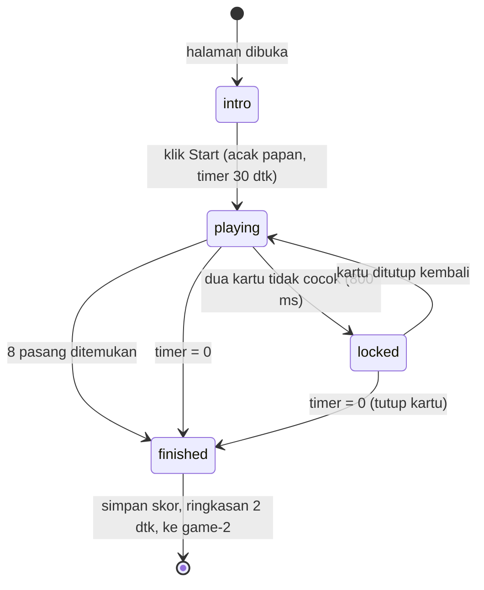
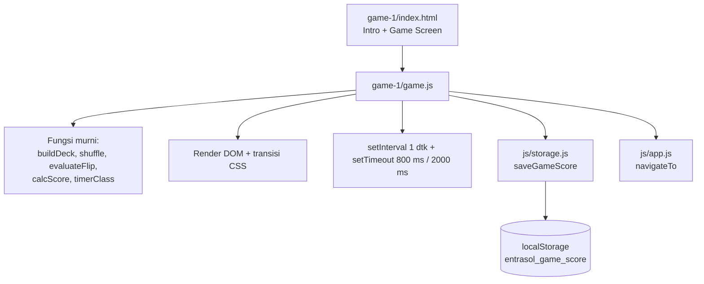

# Dokumen Desain: Memory Flip Game

## Overview

Memory Flip adalah game pertama dari rangkaian tiga mini-game Entrasol. Halaman `game-1/index.html` berisi dua tahap dalam satu file: **Intro_Screen** (judul, petunjuk, badge 30 detik, tombol Start) dan **Game_Screen** (timer, progress bar, skor berjalan, papan kartu 4×4). Pemain mencari 8 pasang gambar identik dalam 30 detik. Tiap pasangan bernilai 5 point (maks 40). Setelah game berakhir, skor ditulis ke LocalStorage lewat `js/storage.js`, ringkasan tampil 2 detik, lalu halaman pindah ke `game-2/index.html`.

### Keputusan Desain Utama

| Keputusan | Alasan |
|-----------|--------|
| Logika dibagi menjadi **fungsi murni** (acak papan, evaluasi pasangan, hitung skor, format timer) dan **lapisan DOM/timer** yang tipis | Fungsi murni mudah diuji, termasuk dengan property-based testing, tanpa DOM |
| State game berupa satu objek `state` dengan *phase* eksplisit (`intro`, `playing`, `locked`, `finished`) | Aturan "abaikan sentuhan" (Req 3.1, 5.4, 5.7, 6.6) menjadi satu pengecekan |
| Fungsi `finishGame(reason)` dijaga flag `finished` | Menjamin skor disimpan dan navigasi terjadi tepat satu kali (Req 7.8) |
| Flip kartu memakai CSS 3D transform + transisi 300 ms | Sesuai Req 4.6 (200–400 ms), tanpa library |
| Ukuran kartu dari `grid` + `aspect-ratio: 1 / 1`, maksimum 100px | Persegi dan proporsional di semua lebar (Req 4.2, 4.3, 8.2) |
| Tampilan mengikuti kelas dan variabel CSS dari `css/style.css` (Home) | Konsisten dengan spec `home-page`; kelas baru memakai prefix `flip-` agar Home tidak berubah (Req 2.6) |
| Link Home diubah dari `game1/index.html` ke `game-1/index.html` | Folder aktual bernama `game-1` (Req 8.11) |
| Next_Game_Page = `game-2/index.html` | Mengikuti penamaan folder aktual `game-1` |

### Catatan Riset

Tidak ada kebutuhan riset eksternal. Desain memakai API browser standar (`localStorage`, `setInterval`/`setTimeout`, CSS `aspect-ratio`, `transform-style: preserve-3d`) dan aset yang sudah ada di workspace (`game-1/assets/back-card.jpg`, `item-1.jpg` sampai `item-8.jpg`, `assets/background-wave.svg`, font Noto Sans lokal).

## Architecture

### Struktur Berkas

```
kiro/
├── index.html            # ubah link Start: game1/ -> game-1/
├── css/style.css         # tambah blok gaya Memory Flip (prefix .flip-)
├── js/
│   ├── storage.js        # BARU: helper LocalStorage (satu-satunya akses localStorage)
│   └── app.js            # BARU: helper navigasi goToNextPage(url)
└── game-1/
    ├── index.html        # Intro_Screen + Game_Screen
    ├── game.js           # logika gameplay
    └── assets/           # back-card.jpg, item-1..8.jpg (sudah ada)
```

### Alur Halaman



### Lapisan Modul



### Urutan Pemuatan Skrip

Di `game-1/index.html`, urutan: `../vendor/bootstrap/bootstrap.bundle.min.js`, `../js/storage.js`, `../js/app.js`, `game.js`. Semua path relatif dan lokal (Req 8.4, 8.5).

## Components and Interfaces

### 1. `js/storage.js` (global `Storage` helper, mis. objek `ScoreStore`)

Satu-satunya berkas yang menyentuh `localStorage` (Req 8.8).

```js
const SCORE_KEY = 'entrasol_game_score';
const DEFAULT_SCORE = { memoryFlip: 0, memoryRecall: 0, memorize: 0, total: 0 };

// Validasi: objek dengan keempat field berupa angka finite
function isValidScore(obj) { /* ... */ }

// Hitung ulang total = memoryFlip + memoryRecall + memorize
function computeTotal(score) { /* ... */ }

// Baca skor; jika localStorage tidak tersedia / JSON rusak / field tidak lengkap -> salinan DEFAULT_SCORE
function getScore() { /* ... */ }

// Simpan skor satu game ('memoryFlip' | 'memoryRecall' | 'memorize'), pertahankan field lain, hitung ulang total.
// Return { ok: boolean, score: object }. Tidak melempar error: kegagalan tulis -> ok:false.
function saveGameScore(gameKey, value) { /* ... */ }

function resetScore() { /* ... */ }
function getTotal() { /* ... */ }
```

`saveGameScore` membungkus `getItem`/`setItem` dengan `try/catch` sehingga game tetap lanjut bila storage tidak tersedia (Req 7.6, 7.7).

### 2. `js/app.js`

```js
// Helper navigasi lintas halaman
function navigateTo(url) { window.location.href = url; }
```

### 3. `game-1/game.js`

Konstanta:

```js
const TOTAL_PAIRS = 8;
const GAME_SECONDS = 30;
const POINTS_PER_PAIR = 5;
const MISMATCH_DELAY_MS = 800;
const SUMMARY_DELAY_MS = 2000;
const WARNING_THRESHOLD = 10;
const NEXT_PAGE = '../game-2/index.html';
```

**Fungsi murni** (tanpa DOM, mudah diuji; diekspos lewat objek `MemoryFlipLogic`, dan di-`module.exports` bila tersedia agar bisa diuji di Node tanpa mengubah perilaku browser):

| Fungsi | Tanda tangan | Perilaku |
|--------|--------------|----------|
| `buildDeck()` | `() => Array<{id, item}>` | 16 kartu: item 1..8 masing-masing dua kali |
| `shuffle(arr, rand = Math.random)` | `(Array, fn) => Array` | Fisher-Yates, mengembalikan salinan baru |
| `evaluateFlip(deck, firstIdx, secondIdx)` | `=> 'match' \| 'mismatch'` | Bandingkan `item` dua kartu |
| `calcScore(pairsFound)` | `=> number` | `5 × pairsFound`, dijepit 0..40 |
| `timerLevel(secondsLeft)` | `=> 'normal' \| 'warning'` | `warning` bila `0 < s <= 10`, selain itu `normal` |
| `canFlip(state, idx)` | `=> boolean` | `true` hanya jika phase `playing`, kartu tertutup, belum cocok, dan kurang dari 2 kartu terbuka |

**State:**

```js
const state = {
  phase: 'intro',        // 'intro' | 'playing' | 'locked' | 'finished'
  deck: [],              // hasil shuffle(buildDeck())
  cardStatus: [],        // per indeks: 'closed' | 'open' | 'matched'
  openIdx: [],           // indeks kartu terbuka yang belum dievaluasi (0..2)
  pairsFound: 0,
  secondsLeft: GAME_SECONDS,
  timerId: null,
  mismatchTimeoutId: null,
  finished: false        // penjaga satu kali simpan + navigasi
};
```

**Fungsi berefek samping (lapisan DOM):**

- `init()` — bind tombol Start, render papan awal tertutup (belum interaktif), tampilkan Intro_Screen.
- `startGame()` — dijaga `phase === 'intro'`; menonaktifkan tombol Start; mengacak papan; reset skor 0 dan `secondsLeft = 30`; tampilkan Game_Screen; `phase = 'playing'`; mulai `setInterval` 1000 ms.
- `onCardClick(idx)` — bila `canFlip` salah, abaikan. Jika benar: buka kartu; bila ini kartu kedua, panggil `evaluateFlip`.
  - `match`: tandai kedua kartu `matched` (kelas `flip-card--matched`, warna `#8BC34A`), `pairsFound++`, perbarui skor dalam <100 ms; bila `pairsFound === 8` panggil `finishGame('complete')`.
  - `mismatch`: `phase = 'locked'`, `setTimeout(800)` lalu tutup kedua kartu dan kembali `playing` (bila belum `finished`).
- `tick()` — kurangi `secondsLeft`, perbarui angka, progress bar, kelas peringatan; bila 0 panggil `finishGame('timeout')`.
- `finishGame(reason)` — bila `state.finished` sudah `true`, langsung return. Selain itu: set `finished = true`, `phase = 'finished'`, `clearInterval`, `clearTimeout(mismatchTimeoutId)`, tutup kartu `open` yang tidak cocok, hitung `score = calcScore(pairsFound)`, panggil `saveGameScore('memoryFlip', score)`, tampilkan ringkasan (jumlah pasangan + skor), `setTimeout(() => navigateTo(NEXT_PAGE), 2000)`.
- `renderTimer()`, `renderScore()`, `renderCard(idx)` — pembaruan DOM.

### 4. Markup `game-1/index.html`

```html
<main class="flip-page">                       <!-- container 430px, gradasi + wave seperti .home-hero -->
  <section id="introScreen" class="flip-intro">
    <p class="flip-eyebrow">GAME 01</p>
    <h1 class="flip-title">Memory Flip</h1>
    <p class="flip-subtitle">Tantangan ini akan menguji daya ingatmu.</p>
    <div class="flip-instruction">
      <p>Pada layar akan terdapat 16 kartu tertutup. ...</p>
      <p>Setiap detik berharga. ...</p>
    </div>
    <span class="flip-time-badge">30 detik</span>
    <button id="startBtn" class="btn btn-entrasol">Start</button>
  </section>

  <section id="gameScreen" class="flip-game" hidden>
    <h2 class="visually-hidden">Papan Permainan</h2>
    <div class="flip-hud">
      <span id="timerText" class="flip-timer" aria-live="off">30</span>
      <span class="flip-score">Skor: <span id="scoreText">0</span></span>
    </div>
    <div class="progress flip-progress" role="progressbar" aria-label="Sisa waktu">
      <div id="timerBar" class="progress-bar"></div>
    </div>
    <div id="board" class="flip-board" role="grid"></div>
    <div id="summary" class="flip-summary" hidden role="status"></div>
  </section>
</main>
```

Heading: tepat satu `h1` ("Memory Flip"); heading lain berurutan (`h2` untuk Game_Screen, `h3` untuk judul ringkasan) sesuai Req 8.10. Urutan elemen Intro_Screen persis: GAME 01 → judul → sub judul → box petunjuk → badge → Start (Req 1.2–1.8).

Struktur satu kartu (tombol agar bisa difokus dan mencapai target sentuh):

```html
<button class="flip-card" data-idx="0" aria-label="Kartu 1, tertutup">
  <span class="flip-card__inner">
    
    
  </span>
</button>
```

### 5. Gaya CSS (tambahan di `css/style.css`)

Memakai variabel yang sudah ada (`--entrasol-blue-dark: #141A8C`, `--entrasol-green`, `--entrasol-white`, `--body-bg`, `--app-max-width`). Hanya menambah kelas baru berprefix `flip-`; kelas Home tidak diubah.

- `.flip-page` — salin gradasi latar dan `::after` wave dari `.home-hero` (`max-width: var(--app-max-width)`, `margin: 0 auto`, `min-height: 100svh`). Bila wave gagal dimuat, gradasi tetap tampil (Req 2.7).
- `.flip-eyebrow` — ukuran kecil, bold, Biru_Tua; `.flip-title` — `2rem` (lebih besar dari eyebrow, Req 1.3); `.flip-subtitle` `1rem`.
- `.flip-instruction` — latar putih, `border: 2px solid var(--entrasol-blue-dark)`, `border-radius: 1rem` (≥ 8px), teks ≥ 16px.
- `.flip-time-badge` — pill Biru_Tua dengan teks putih.
- `.btn-entrasol` dipakai ulang untuk Start (pill, `min-height: 48px`, Req 2.3).
- `.flip-board` — `display: grid; grid-template-columns: repeat(4, minmax(0, 1fr)); gap: 8px; width: min(100%, 4 * 100px + 3 * 8px)` sehingga kartu tidak melebihi 100px dan mengecil proporsional di layar sempit.
- `.flip-card` — `aspect-ratio: 1 / 1`, `min-width/min-height: 44px`, `border-radius: 12px`, `box-shadow` halus, `perspective: 600px`, `padding: 0; border: 0; background: none`.
- `.flip-card__inner` — `transform-style: preserve-3d; transition: transform 0.3s`; `.flip-card.is-open .flip-card__inner { transform: rotateY(180deg) }`.
- `.flip-card__face` — `position: absolute; inset: 0; width/height: 100%; object-fit: cover; backface-visibility: hidden; border-radius: inherit`; `.flip-card__front { transform: rotateY(180deg) }`.
- `.flip-card--matched` — `outline/box-shadow` berwarna `#8BC34A` (`--entrasol-green`).
- `.flip-timer--warning` — warna peringatan (mis. `#D32F2F`, kontras dengan Biru_Tua), tidak hanya mengandalkan warna karena angka tetap tampil.
- Mobile-first: gaya default untuk 320px; `@media (min-width: 576px)` hanya menambah ruang (padding dan ukuran font), tanpa mengubah rasio kartu.

## Data Models

### Skor di LocalStorage (key `entrasol_game_score`)

```json
{ "memoryFlip": 0, "memoryRecall": 0, "memorize": 0, "total": 0 }
```

Invarian: `total = memoryFlip + memoryRecall + memorize`; `memoryFlip` ∈ {0, 5, 10, …, 40}.

### Kartu (Card)

```js
{ id: 0..15, item: 1..8 }   // item menentukan file assets/item-{item}.jpg
```

Dek berisi tepat dua kartu untuk tiap `item` 1..8.

### State Game

Lihat objek `state` pada bagian Components. Status kartu: `closed` → `open` → (`matched` | kembali `closed`).

### Aturan Transisi State

| Dari | Peristiwa | Ke |
|------|-----------|----|
| `intro` | klik Start | `playing` |
| `playing` | kartu ke-2 tidak cocok | `locked` |
| `locked` | 800 ms berlalu | `playing` |
| `playing` / `locked` | `pairsFound = 8` atau `secondsLeft = 0` | `finished` |
| `finished` | (apa pun) | tetap `finished` |


## Correctness Properties

*A property is a characteristic or behavior that should hold true across all valid executions of a system-essentially, a formal statement about what the system should do. Properties serve as the bridge between human-readable specifications and machine-verifiable correctness guarantees.*

Properti berlaku untuk fungsi murni di `game-1/game.js` (`buildDeck`, `shuffle`, `evaluateFlip`, `calcScore`, `timerLevel`, `canFlip`, `finishGame`) dan helper `js/storage.js`. Aspek tampilan (CSS, layout, teks statis) tidak diuji dengan PBT.

### Property 1: Pengacakan mempertahankan komposisi dek

*For any* sumber acak (fungsi `rand` yang dihasilkan secara acak), dek hasil `shuffle(buildDeck(), rand)` SHALL berisi tepat 16 kartu dan setiap item 1 sampai 8 SHALL muncul tepat dua kali.

**Validates: Requirements 3.3, 4.5**

### Property 2: Evaluasi pasangan sesuai kesamaan gambar

*For any* dek hasil acak dan *any* dua indeks kartu berbeda, `evaluateFlip` SHALL mengembalikan `'match'` jika dan hanya jika kedua kartu memiliki `item` yang sama, dan `'mismatch'` jika berbeda.

**Validates: Requirements 5.2, 5.3**

### Property 3: Kartu hanya dapat dibuka pada kondisi yang valid

*For any* state game (phase apa pun, status kartu apa pun, jumlah kartu terbuka 0 sampai 2) dan *any* indeks kartu 0 sampai 15, `canFlip(state, idx)` SHALL bernilai `true` jika dan hanya jika phase adalah `playing`, status kartu `closed`, dan jumlah kartu terbuka belum dievaluasi kurang dari 2. Untuk phase `intro`, `locked`, dan `finished` hasilnya SHALL selalu `false`.

**Validates: Requirements 3.1, 5.1, 5.4, 5.5, 5.7, 6.6**

### Property 4: Skor sama dengan 5 kali jumlah pasangan

*For any* jumlah pasangan ditemukan `n` bilangan bulat 0 sampai 8, `calcScore(n)` SHALL sama dengan `5 × n`, merupakan kelipatan 5, dan berada pada rentang 0 sampai 40. Skor SHALL hanya bergantung pada `n`, sehingga kartu tidak cocok yang masih terbuka saat game berakhir tidak mengubah hasil.

**Validates: Requirements 5.6, 6.8, 7.2**

### Property 5: Level peringatan timer

*For any* sisa waktu bilangan bulat `s` dari 0 sampai 30, `timerLevel(s)` SHALL bernilai `'warning'` jika dan hanya jika `0 < s ≤ 10`, dan `'normal'` untuk nilai lainnya.

**Validates: Requirements 6.3**

### Property 6: Round trip penyimpanan skor Memory Flip

*For any* jumlah pasangan `n` dari 0 sampai 8, memanggil `saveGameScore('memoryFlip', calcScore(n))` lalu `getScore().memoryFlip` SHALL menghasilkan `5 × n`.

**Validates: Requirements 7.1, 7.2, 7.9**

### Property 7: Penyimpanan menjaga total dan field game lain

*For any* skor awal valid di LocalStorage (nilai `memoryRecall` dan `memorize` acak) dan *any* nilai `memoryFlip` kelipatan 5 dalam 0 sampai 40, setelah `saveGameScore('memoryFlip', value)` skor hasil SHALL memiliki `memoryRecall` dan `memorize` yang tidak berubah, `memoryFlip` sama dengan `value`, dan `total = memoryFlip + memoryRecall + memorize`.

**Validates: Requirements 7.3, 7.4**

### Property 8: Data tersimpan tidak valid jatuh ke skor awal

*For any* isi LocalStorage yang tidak valid (string bukan JSON, JSON bukan objek, objek dengan field hilang atau bukan angka) atau storage yang melempar error saat dibaca, `getScore()` SHALL mengembalikan `{ memoryFlip: 0, memoryRecall: 0, memorize: 0, total: 0 }`, dan `saveGameScore` SHALL tidak melempar error meskipun penulisan gagal.

**Validates: Requirements 7.6, 7.7**

### Property 9: Skor disimpan dan navigasi terjadi tepat sekali

*For any* barisan pemanggilan `finishGame` (kombinasi alasan `'complete'` dan `'timeout'`, panjang 1 atau lebih, urutan acak), penyimpanan skor dan navigasi ke Next_Game_Page SHALL dipicu tepat satu kali.

**Validates: Requirements 7.8**

## Error Handling

| Situasi | Penanganan |
|---------|-----------|
| `localStorage` tidak tersedia (mode privat, diblokir) | `getScore`/`saveGameScore` dibungkus `try/catch`; memakai skor awal; game tetap lanjut (Req 7.6) |
| Data skor rusak atau tidak lengkap | `isValidScore` gagal, pakai salinan `DEFAULT_SCORE` sebagai dasar tulis (Req 7.6) |
| `setItem` gagal (kuota penuh) | `saveGameScore` mengembalikan `ok: false`; ringkasan tetap menampilkan skor sesi dan navigasi tetap berjalan (Req 7.7) |
| Dua pemicu akhir hampir bersamaan (8 pasang dan timer 0) | Flag `state.finished` membuat panggilan kedua `finishGame` diabaikan (Req 7.8) |
| Klik Start berulang | Tombol dinonaktifkan dan `startGame` dijaga `phase === 'intro'` (Req 3.6) |
| Klik cepat pada kartu saat animasi flip | `canFlip` memeriksa status kartu dan jumlah kartu terbuka sebelum menerima klik (Req 5.4, 5.5) |
| Timer habis saat dua kartu tidak cocok terbuka | `finishGame` membatalkan `mismatchTimeoutId`, menutup kartu tersebut, dan skor tetap `calcScore(pairsFound)` (Req 5.8, 6.8) |
| Gambar kartu gagal dimuat | Atribut `alt` tampil; elemen kartu tetap berukuran sama karena ukuran ditentukan CSS grid (Req 4.7) |
| `background-wave.svg` gagal dimuat | Gradasi latar tetap tampil, konten tidak terpotong (Req 2.7) |
| Tab disembunyikan lalu `setInterval` tertahan | Timer dihitung dari tick 1 detik sesuai spesifikasi; tidak ada kompensasi tambahan (diterima untuk game 30 detik) |

## Testing Strategy

### Pendekatan Ganda

Pengujian memakai kombinasi unit test (contoh, edge case) dan property-based test (properti universal). Aturan workspace melarang build tool pada aplikasi, sehingga berkas uji ditaruh terpisah dari halaman produksi (mis. `tests/`) dan dijalankan di Node hanya sebagai alat pengembang. Aplikasi sendiri tetap dapat dibuka langsung di browser tanpa langkah build.

Agar fungsi murni dapat diuji di Node tanpa mengubah perilaku browser, `game.js` dan `storage.js` mengekspos fungsi lewat objek global dan `if (typeof module !== 'undefined') module.exports = ...`.

### Property-Based Testing

- Library: **fast-check** (dev dependency, versi dipin; hanya untuk pengujian, tidak dimuat di halaman).
- Setiap properti diimplementasikan dengan **satu** property-based test.
- Konfigurasi minimum **100 iterasi** per properti (`numRuns: 100`).
- Tiap test diberi komentar tag dengan format: `Feature: memory-flip-game, Property {nomor}: {teks properti}`.
- `localStorage` diganti mock in-memory (dengan varian yang melempar error) untuk Property 6 sampai 9; `navigateTo` dan `saveGameScore` di-mock sebagai spy untuk Property 9.

| Properti | Generator |
|----------|-----------|
| 1 | Fungsi `rand` dari barisan float acak 0..1 |
| 2 | Dek hasil shuffle + pasangan indeks berbeda `fc.integer(0,15)` |
| 3 | State acak (phase, status 16 kartu, jumlah terbuka) + indeks |
| 4 | `fc.integer({min:0,max:8})` |
| 5 | `fc.integer({min:0,max:30})` |
| 6 | `fc.integer({min:0,max:8})` |
| 7 | Skor awal acak valid + nilai kelipatan 5 |
| 8 | String acak, JSON tak lengkap, tipe salah, storage yang melempar error |
| 9 | Array alasan `fc.array(fc.constantFrom('complete','timeout'), {minLength:1})` |

### Unit Test (Contoh dan Edge Case)

Dengan fake timers dan DOM sederhana (mis. jsdom sebagai dev dependency pinned):

- Intro_Screen: urutan elemen "GAME 01" → judul → sub judul → box petunjuk → badge → Start; satu `h1` (Req 1, 8.10).
- Start: Intro disembunyikan, Game_Screen tampil, 16 kartu tertutup, skor 0, tombol Start nonaktif (Req 3.2, 3.5, 3.6).
- Timer: maju 30 detik menampilkan 30 → 0 dan berhenti; kelas peringatan muncul pada 10 sampai 1 (Req 3.4, 6.1–6.3).
- Mismatch: dua kartu beda tetap terbuka 800 ms lalu tertutup; klik ketiga diabaikan selama jeda (Req 5.3, 5.4).
- Timer habis saat mismatch: kartu ditutup, skor tidak berubah, klik berikutnya diabaikan (Req 5.8).
- Selesai: ringkasan tampil, `navigateTo('../game-2/index.html')` dipanggil setelah 2000 ms, tepat sekali (Req 6.7, 7.5).
- Kegagalan storage: `setItem` melempar error, ringkasan dan navigasi tetap berjalan (Req 7.7).

### Smoke dan Pemeriksaan Visual

- Scan statis `game-1/index.html`, `game-1/game.js`, `css/style.css`: tidak ada `http://`, `https://`, atau `//` untuk aset; `localStorage` hanya muncul di `js/storage.js`; urutan skrip dan path relatif benar (Req 8.4–8.8).
- `index.html` Home mengarah ke `game-1/index.html` (Req 8.11).
- Pemeriksaan visual manual pada lebar 320, 768, dan 1280 px: tanpa scroll horizontal, kartu persegi 44 sampai 100 px, gap 4 sampai 12 px, animasi flip 300 ms, wave dan gradasi sesuai Home (Req 2, 4, 8.1–8.3, 8.9).

### Alasan Cakupan PBT

PBT dipakai untuk logika murni (pengacakan, pencocokan, skor, validasi aksi, serialisasi skor) yang inputnya bervariasi luas. Layout, gaya, animasi, dan teks statis tidak cocok untuk PBT, sehingga diuji dengan contoh, smoke test, dan pemeriksaan visual.
