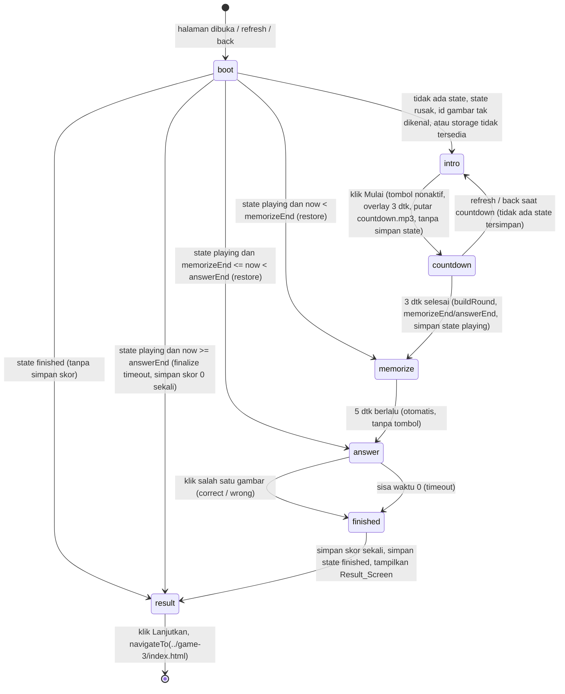
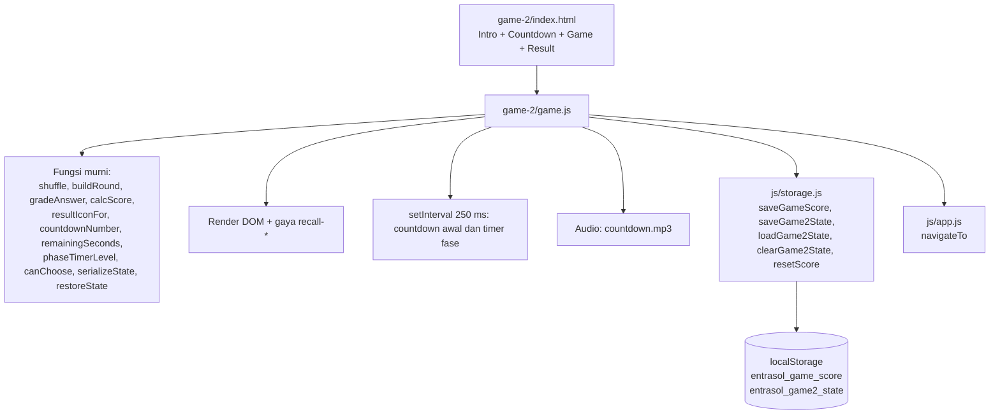

# Dokumen Desain: Memory Recall Game

## Overview

Memory Recall adalah game kedua dari rangkaian tiga mini-game Entrasol. Halaman `game-2/index.html` berisi **tiga tampilan utama dalam satu file** (hanya satu yang terlihat pada satu waktu) ditambah satu overlay sementara, Countdown_Screen, yang tampil di depan Game_Screen:

- **Intro_Screen** (`#introScreen`): teks "GAME 02", ikon game, judul `h1` "Memory Recall", sub judul, Instruction_Box berisi dua paragraf petunjuk dan Time_Alert (dua keterangan waktu), tombol "Mulai".
- **Countdown_Screen** (`#countdownScreen`): overlay penuh di dalam `main.recall-page` yang menutupi Game_Screen selama 3 detik setelah "Mulai" ditekan, menampilkan "Bersiap..." dan angka besar 3, 2, 1. Di belakang overlay hanya ada bingkai kosong; Round baru dipilih setelah countdown selesai. Tidak memakai heading dan tidak pernah disimpan sebagai sesi.
- **Game_Screen** (`#gameScreen`): `h2` "Memory Recall", Phase_Badge (`#phaseBadge`), angka timer (`#timerText`), progress bar (`#timerBar`), teks arahan (`#prompt`), dan area gambar (`#stage`).
- **Result_Screen** (`#resultScreen`): `h2` "Memory Recall", ikon hasil (`checked.png` / `wrong.png` / `times-up.png`), skor besar (30 atau 0) dengan keterangan "point" dan "dari 30", tombol "Lanjutkan" (`#continueBtn`) menuju `../game-3/index.html`.

Pemain melihat satu gambar target selama 5 detik (Fase_Mengingat), lalu otomatis beralih ke Fase_Memilih selama 5 detik berisi tiga gambar pilihan dalam susunan piramida (1 di atas, 2 di bawah). Penilaian all-or-nothing: benar 30 point, salah atau waktu habis 0 point. Skor ditulis ke LocalStorage (`memoryRecall`) lewat `js/storage.js` tepat satu kali, lalu Result_Screen ditampilkan di halaman yang sama. Tidak ada navigasi otomatis: pindah ke game-3 hanya saat pemain menekan "Lanjutkan".

Alur tampilan: **Intro_Screen → Countdown_Screen → Game_Screen (Fase_Mengingat → Fase_Memilih) → Result_Screen**.

State sesi disimpan di key `entrasol_game2_state` saat permainan dimulai (setelah countdown). Refresh atau tombol back tidak mengulang permainan: ronde berjalan dilanjutkan berdasarkan waktu absolut (`memorizeEnd`, `answerEnd`), dan permainan selesai langsung menampilkan Result_Screen. Refresh saat Countdown_Screen kembali ke Intro_Screen karena belum ada state tersimpan.

Tema visual hijau muda `#8BC34A` (selaras dengan warna item "Memory Recall" di Home): body `rgba(139,195,74,0.2)` lewat kelas `recall-body`, container `main.recall-page` 430px dengan gradasi putih ke `rgba(139,195,74,0.45)` dan wave `assets/background-wave.svg` lewat `::after`. Tombol utama berkelas `btn-recall` (latar hijau, teks Biru_Tua `#141A8C` karena kontras).

### Keputusan Desain Utama

| Keputusan | Alasan |
|-----------|--------|
| Logika dibagi menjadi **fungsi murni** (`shuffle`, `buildRound`, `gradeAnswer`, `calcScore`, `resultIconFor`, `countdownNumber`, `remainingSeconds`, `phaseTimerLevel`, `canChoose`, `serializeState`, `restoreState`) dan **lapisan DOM/timer/audio** yang tipis | Fungsi murni mudah diuji termasuk dengan property-based testing tanpa DOM |
| **Aturan pemilihan gambar baru:** target dipilih dari gambar yang punya saudara (gambar lain dengan `group` sama) **dan** ada gambar dari group lain; pilihan = target + satu saudara sejenis (Sibling_Image) + satu gambar group lain, posisi diacak | Pengecoh sejenis (mis. `1-a` vs `1-b`) membuat tantangan lebih bermakna. Dengan 4 gambar: 4 target × 2 pengecoh group lain × 6 permutasi = **48 kemungkinan Round**. Contoh: target `1-a` → pilihan `1-a`, `1-b`, dan (`2-a` atau `2-b`) dalam urutan acak (Req 4.2–4.4) |
| `buildRound(images, rand)` mengembalikan `null` bila tidak ada kandidat target (tidak ada gambar bersaudara, tidak ada group lain, atau gambar < 3) | Tombol "Mulai" dinonaktifkan tanpa error; aset baru cukup menambah entri `CARD_IMAGES` (Req 4.6, 4.7) |
| State game berupa satu objek `state` dengan *phase* eksplisit (`intro`, `countdown`, `memorize`, `answer`, `finished`) dan flag `finished` | Aturan "abaikan klik" (Req 6.8, 6.9) menjadi satu pengecekan `canChoose`; phase `countdown` menolak Mulai ganda |
| Start dipecah menjadi `beginCountdown()` lalu `startGame()` | Pemain mendapat jeda 3 detik tanpa memotong waktu 5+5 detik |
| **Round dan batas waktu dihitung di `startGame()` setelah countdown** (`memorizeEnd = now + 5000`, `answerEnd = memorizeEnd + 5000`) | Countdown tidak memotong waktu; bingkai di belakang overlay kosong sehingga gambar tidak terlihat sebelum waktunya (Req 3.1, 3.7) |
| **Tidak ada Game_Session_State yang disimpan selama phase `countdown`** | Refresh atau back saat countdown menghasilkan sesi baru (Intro_Screen) (Req 3.6, 9.9) |
| **Waktu absolut** (`memorizeEnd`, `answerEnd`) disimpan di state; sisa waktu dihitung ulang dari `Date.now()` | Refresh tidak mengulang Fase_Mengingat dan waktu saat halaman tertutup tetap terhitung (Req 9.4–9.6) |
| Fase_Mengingat beralih otomatis ke Fase_Memilih tanpa tombol | Sesuai aturan produk dua fase 5+5 detik (Req 5.5) |
| Interval ~250 ms yang menghitung ulang sisa detik dan merender hanya saat nilainya berubah | Pergantian detik tepat walau interval tertahan, tanpa render berlebihan |
| State sesi di **key terpisah** `entrasol_game2_state`, bukan di `entrasol_game_score` | Skema skor tetap sesuai aturan workspace |
| Result_Screen di **halaman yang sama** lewat atribut `hidden`, **tanpa `pushState`** | Tombol back kembali ke halaman sebelumnya (Req 7.3, 9.10, 9.11) |
| `finishGame` dijaga flag `finished` dan menyimpan skor tepat sekali; reload dengan fase `finished` tidak menyimpan ulang | Skor tidak ganda (Req 8.1, 9.7) |
| Audio hanya `countdown.mp3` pada Countdown_Screen, `playSound` tidak pernah melempar | Autoplay diblokir tidak boleh mengganggu permainan (Req 3.5, 3.9, 3.10) |
| Tombol "Mulai"/"Lanjutkan" berlatar hijau dengan teks Biru_Tua | Kontras Biru_Tua terhadap hijau > 4,5:1, sedangkan putih < 3:1 (Req 2.6) |
| Ukuran gambar `--recall-img` dibatasi tinggi layar | Judul, badge, timer, teks arahan, dan dua baris piramida muat di 550px (Req 10.4) |
| Fungsi murni diekspos lewat `MemoryRecallLogic` dan `module.exports` | Dapat diuji di Node tanpa mengubah perilaku browser |

### Catatan Riset

Tidak ada kebutuhan riset eksternal. Desain memakai API browser standar (`localStorage`, `Date.now`, `setInterval`, `Audio`, CSS `aspect-ratio`, `clamp()`, `min()`, atribut `hidden`) dan aset yang sudah ada: `game-2/assets/{1-a,1-b,2-a,2-b}.jpg` (360×360), `checked.png`, `wrong.png`, `times-up.png`, `audio/countdown.mp3`, `assets/icon-game-2.svg`, `assets/background-wave.svg`, dan font Noto Sans lokal. Pola arsitektur mengikuti game-1 (`memory-flip-game`).

## Architecture

### Struktur Berkas

```
kiro/
├── index.html            # Home (tidak berubah)
├── css/style.css         # + blok gaya Memory Recall (prefix .recall-, body.recall-body)
├── js/
│   ├── storage.js        # + GAME2_STATE_KEY dan fungsi state game-2; resetScore ikut menghapus state game-2
│   └── app.js            # navigateTo(url) (tidak berubah)
├── game-2/
│   ├── index.html        # Intro + Countdown + Game + Result Screen
│   ├── game.js           # CARD_IMAGES, fungsi murni, state runtime, lapisan DOM/timer/audio
│   └── assets/           # 1-a/1-b/2-a/2-b.jpg, checked/wrong/times-up.png, audio/countdown.mp3
└── tests/                # (dibuat saat tugas pengujian) property + unit test, hanya alat pengembang
```

### Alur Halaman (State Diagram)



`finished` adalah phase internal sesaat; hasilnya selalu Result_Screen. Tidak ada transisi otomatis keluar dari `result`.

### Lapisan Modul



### Urutan Pemuatan Skrip

Di `game-2/index.html`: `../vendor/bootstrap/bootstrap.bundle.min.js`, `../js/storage.js`, `../js/app.js`, `game.js`. Semua path relatif dan lokal (Req 10.7, 10.8).

## Components and Interfaces

### 1. `js/storage.js` (tambahan)

Tetap menjadi satu-satunya berkas yang menyentuh `localStorage` (Req 8.5).

```js
const GAME2_STATE_KEY = 'entrasol_game2_state';

// Validasi ketat, murni (tanpa localStorage), diekspos untuk pengujian.
function isValidGame2State(obj) { /* lihat tabel aturan */ }

// Simpan state; return { ok: boolean }. Tidak melempar: kegagalan tulis -> ok:false.
function saveGame2State(stateObj) { /* JSON.stringify -> setItem(GAME2_STATE_KEY) */ }

// Baca state; objek valid atau null bila tidak ada / JSON rusak / tidak valid / storage error.
function loadGame2State() { /* getItem -> JSON.parse -> isValidGame2State ? obj : null */ }

// Hapus state; tidak melempar.
function clearGame2State() { /* removeItem(GAME2_STATE_KEY) */ }

// resetScore (diubah): setItem(SCORE_KEY, DEFAULT) + clearGame1State() + clearGame2State()
```

**Aturan validasi `isValidGame2State`** (semua harus terpenuhi, selain itu `loadGame2State` mengembalikan `null`):

| Field | Aturan |
|-------|--------|
| objek | bukan `null`, bukan array |
| `phase` | tepat `'playing'` atau `'finished'` |
| `targetId` | string tidak kosong |
| `optionIds` | array 3 string tidak kosong, semuanya unik, dan memuat `targetId` |
| `memorizeEnd`, `answerEnd` | angka finite dan `answerEnd > memorizeEnd` |
| `result` | bila `finished`: salah satu `'correct'`, `'wrong'`, `'timeout'`; bila `playing`: tidak ada atau diabaikan |
| `score` | bila `finished`: `30` jika `result === 'correct'`, selain itu `0`; bila `playing`: diabaikan |

`resetScore` yang ikut menghapus state game-2 memastikan sesi baru dari Home selalu bersih (Req 9.1, 11.2). Fungsi baru diekspos lewat objek global dan `module.exports`.

### 2. `js/app.js`

```js
function navigateTo(url) { window.location.href = url; }
```

Tidak berubah. `game-2/game.js` memanggilnya hanya dari `#continueBtn`.

### 3. `game-2/game.js`

Konstanta:

```js
const MEMORIZE_SECONDS = 5;
const ANSWER_SECONDS = 5;
const PRE_COUNTDOWN_SECONDS = 3;
const TICK_INTERVAL_MS = 250;
const WARNING_THRESHOLD = 2;
const MAX_SCORE = 30;
const NEXT_PAGE = '../game-3/index.html';

// Satu-satunya daftar gambar (Req 4.1). Menambah gambar = menambah satu entri.
const CARD_IMAGES = [
  { id: '1-a', group: '1', src: 'assets/1-a.jpg', alt: 'Kemasan Entrasol Active rasa Choco Delight' },
  { id: '1-b', group: '1', src: 'assets/1-b.jpg', alt: 'Kemasan Entrasol Active rasa Vanilla Latte' },
  { id: '2-a', group: '2', src: 'assets/2-a.jpg', alt: 'Kemasan Entrasol Gold rasa Chocolate' },
  { id: '2-b', group: '2', src: 'assets/2-b.jpg', alt: 'Kemasan Entrasol Gold rasa Vanilla' }
];
```

**Fungsi murni** (tanpa DOM dan tanpa localStorage; diekspos lewat `MemoryRecallLogic` dan `module.exports` bila tersedia):

| Fungsi | Tanda tangan | Perilaku |
|--------|--------------|----------|
| `shuffle(arr, rand = Math.random)` | `(Array, fn) => Array` | Fisher-Yates, mengembalikan salinan baru |
| `buildRound(images, rand = Math.random)` | `(Array, fn) => {targetId, optionIds} \| null` | Lihat algoritma di bawah |
| `gradeAnswer(targetId, chosenId)` | `=> 'correct' \| 'wrong'` | `correct` bila id sama |
| `calcScore(status)` | `=> 30 \| 0` | 30 untuk `correct`, selain itu 0 |
| `resultIconFor(status)` | `=> {src, alt}` | `correct` → `assets/checked.png` / "Jawaban benar"; `wrong` → `assets/wrong.png` / "Jawaban salah"; `timeout` → `assets/times-up.png` / "Waktu habis" |
| `countdownNumber(elapsedMs)` | `=> 3 \| 2 \| 1 \| 0` | `< 1000` → 3, `< 2000` → 2, `< 3000` → 1, `>= 3000` → 0 (selesai); negatif atau non-finite → 3 |
| `remainingSeconds(endTime, now, maxSeconds = 5)` | `=> integer 0..5` | `clamp(ceil((endTime - now) / 1000), 0, maxSeconds)` |
| `phaseTimerLevel(secondsLeft)` | `=> 'normal' \| 'warning'` | `warning` bila `0 < s <= 2` |
| `canChoose(state)` | `=> boolean` | `true` hanya bila `state.phase === 'answer'` dan `state.finished === false` |
| `serializeState(state, phase)` | `=> Game_Session_State` | Membentuk `{ phase, targetId, optionIds, memorizeEnd, answerEnd }`; bila `phase === 'finished'` menambah `result` dan `score = calcScore(result)` |
| `restoreState(saved, now)` | `=> RestoreResult` | Menentukan mode boot (lihat di bawah) |

**Algoritma `buildRound(images, rand)`:**

1. Kandidat target = gambar `t` sehingga ada gambar lain dengan `group` sama (punya saudara) **dan** ada gambar dengan `group` berbeda.
2. Bila kandidat kosong (termasuk `images.length < 3`), kembalikan `null`.
3. `targetId` = elemen acak dari kandidat.
4. `sibling` = elemen acak dari gambar ber-`group` sama selain target.
5. `other` = elemen acak dari gambar ber-`group` berbeda.
6. `optionIds = shuffle([targetId, sibling.id, other.id], rand)`.
7. Kembalikan `{ targetId, optionIds }`. Array `images` tidak diubah.

Contoh: target `1-a` → pilihan `1-a`, `1-b`, dan (`2-a` atau `2-b`) dalam urutan acak. Hasilnya selalu tiga id unik; target tepat sekali; tepat satu pengecoh sejenis dan satu pengecoh dari group lain.

**Hasil `restoreState(saved, now)`:**

```js
// saved = null atau Game_Session_State valid (hasil loadGame2State)
{ mode: 'intro' }                                              // saved === null
{ mode: 'result', result, score, needsFinalize: false }        // saved.phase === 'finished'
{ mode: 'result', result: 'timeout', score: 0,
  needsFinalize: true }                                        // playing dan now >= answerEnd
{ mode: 'playing', stage: 'memorize', targetId, optionIds,
  memorizeEnd, answerEnd,
  secondsLeft: remainingSeconds(memorizeEnd, now) }            // playing dan now < memorizeEnd
{ mode: 'playing', stage: 'answer', targetId, optionIds,
  memorizeEnd, answerEnd,
  secondsLeft: remainingSeconds(answerEnd, now) }              // playing dan memorizeEnd <= now < answerEnd
```

`restoreState` tidak membaca storage dan tidak menyentuh DOM.

**State runtime:**

```js
const state = {
  phase: 'intro',        // 'intro' | 'countdown' | 'memorize' | 'answer' | 'finished'
  round: null,           // { targetId, optionIds }
  memorizeEnd: 0,        // timestamp ms absolut
  answerEnd: 0,
  secondsLeft: MEMORIZE_SECONDS,
  timerId: null,
  countdownId: null,     // interval countdown awal (null bila tidak aktif)
  finished: false        // penjaga satu kali simpan skor
};
```

**Audio:**

```js
let countdownSound = null;
try { countdownSound = new Audio('assets/audio/countdown.mp3'); } catch (e) {}

function playSound(name) { /* currentTime = 0; play(); Promise ditolak ditangkap; tidak melempar */ }
function stopSound(name)  { /* pause(); currentTime = 0; tidak melempar */ }
```

`playSound('countdown')` dipanggil tepat sekali di `beginCountdown()`; `stopSound('countdown')` dipanggil oleh `cancelCountdown()`. Tidak ada pemutaran di Game_Screen atau saat restore (Req 3.10).

**Fungsi berefek samping (lapisan DOM):**

- `init()` — memanggil `restoreState(loadGame2State(), Date.now())`:
  - `intro`: bila `buildRound(CARD_IMAGES, Math.random)` bernilai `null`, tombol `#startBtn` dinonaktifkan; selain itu bind Mulai ke `beginCountdown` dan daftarkan `pagehide` → `cancelCountdown`.
  - `playing`: bila `targetId`/`optionIds` memuat id yang tidak ada di `CARD_IMAGES` → `clearGame2State()` lalu perilaku `intro`. Selain itu set `state.round`, `memorizeEnd`, `answerEnd`, tampilkan Game_Screen pada stage `memorize` atau `answer`, jalankan `startTimer()` (Countdown_Screen tetap tersembunyi).
  - `result`: bila `needsFinalize`, panggil `saveGameScore('memoryRecall', 0)` tepat sekali dan `saveGame2State(serializeState(..., 'finished'))`, lalu `showResult`. Bila sudah `finished`, langsung `showResult` tanpa menyimpan skor.
  - `#continueBtn` di-bind pada semua mode ke `navigateTo(NEXT_PAGE)`.
- `beginCountdown()` — dijaga `phase === 'intro'`. Menonaktifkan Mulai, `phase = 'countdown'`, menyembunyikan Intro_Screen, menampilkan Game_Screen dengan `renderEmptyStage()` (bingkai kosong tanpa gambar), menampilkan `#countdownScreen`, `playSound('countdown')` sekali, `t0 = Date.now()`, dan `countdownId = setInterval(...)` yang menghitung `n = countdownNumber(Date.now() - t0)` serta memperbarui `#countdownNumber` hanya saat `n` berubah. Saat `n === 0`: bersihkan interval, sembunyikan overlay, panggil `startGame()`. Tidak memanggil `saveGame2State`.
- `cancelCountdown()` — pada `pagehide`: bila `countdownId !== null`, `clearInterval`, `countdownId = null`, `stopSound('countdown')`.
- `startGame()` — dijaga `phase === 'countdown'`: `round = buildRound(CARD_IMAGES, Math.random)`; `memorizeEnd = Date.now() + 5000`; `answerEnd = memorizeEnd + 5000`; `saveGame2State(serializeState(state, 'playing'))`; `enterMemorize()`; `startTimer()`.
- `enterMemorize()` / `enterAnswer()` — mengatur `phase`, memanggil `renderMemorize()` / `renderAnswer()`, dan mereset tampilan timer.
- `startTimer()` / `tick()` — interval 250 ms. `tick` menghitung sisa detik dari batas waktu fase aktif dengan `remainingSeconds`, merender hanya saat nilai berubah. Bila `now >= memorizeEnd` pada phase `memorize` → `enterAnswer()` otomatis. Bila `now >= answerEnd` → `finishGame('timeout')`.
- `onOptionClick(id)` — abaikan bila `!canChoose(state)`; selain itu `finishGame(gradeAnswer(round.targetId, id))`.
- `finishGame(status)` — dijaga `state.finished`. Selain itu: `finished = true`, `phase = 'finished'`, `clearInterval(timerId)`, `saveGameScore('memoryRecall', calcScore(status))` tepat sekali (dibungkus `try/catch`), `saveGame2State(serializeState(state, 'finished'))` (hasil `ok:false` diabaikan), lalu `showResult(status, score)`. Tidak ada `setTimeout` navigasi.
- `showResult(status, score)` — mengisi `#resultIcon` (`src`, `alt` dari `resultIconFor`) dan `#resultScore`, menyembunyikan Intro/Game, menampilkan Result. Tanpa `history.pushState`.
- `renderEmptyStage()`, `renderMemorize()`, `renderAnswer()`, `renderTimer()` — pembaruan DOM. `init()` dipanggil pada `DOMContentLoaded` hanya bila `document` tersedia.

### 4. Markup `game-2/index.html`

```html
<body class="recall-body">
<main class="recall-page">
  <section id="introScreen" class="recall-intro">
    <p class="recall-eyebrow">GAME 02</p>
    
    <h1 class="recall-title">Memory Recall</h1>
    <p class="recall-subtitle">Amati baik-baik gambar yang muncul di layar.</p>
    <div class="recall-instruction">
      <p>Satu gambar akan ditampilkan selama 5 detik. Perhatikan setiap detailnya dan ingat baik-baik!</p>
      <p>Setelah gambar menghilang, temukan gambar yang sama di antara 3 pilihan yang tersedia!</p>
      <div class="recall-time-alert" role="note">
        <span>Waktu mengingat gambar: 5 detik</span>
        <span>Waktu memilih gambar: 5 detik</span>
      </div>
    </div>
    <button type="button" id="startBtn" class="btn btn-recall">Mulai</button>
  </section>

  <section id="countdownScreen" class="recall-countdown" hidden>
    <p class="recall-countdown__label">Bersiap...</p>
    <div id="countdownNumber" class="recall-countdown__number" role="status" aria-live="assertive">3</div>
  </section>

  <section id="gameScreen" class="recall-game" hidden>
    <h2 class="recall-game-title">Memory Recall</h2>
    <span id="phaseBadge" class="recall-badge recall-badge--memorize">Hafalkan!</span>
    <span id="timerText" class="recall-timer" aria-live="off">5</span>
    <div class="progress recall-progress" role="progressbar" aria-label="Sisa waktu" aria-valuemin="0" aria-valuemax="5" aria-valuenow="5">
      <div id="timerBar" class="progress-bar"></div>
    </div>
    <p id="prompt" class="recall-prompt">Perhatikan gambar berikut</p>
    <div id="stage" class="recall-stage"></div>
  </section>

  <section id="resultScreen" class="recall-result" hidden>
    <h2 class="recall-result__title">Memory Recall</h2>
    
    <p class="recall-result__score">
      <span id="resultScore" class="recall-result__number">0</span>
      <span class="recall-result__unit">point</span>
      <span class="recall-result__max">dari 30</span>
    </p>
    <button type="button" id="continueBtn" class="btn btn-recall">Lanjutkan</button>
  </section>
</main>
```

`section#countdownScreen` berada di dalam `main.recall-page` agar overlay hanya menutupi container 430px, tanpa heading; angka berada di elemen ber-`role="status"` dan `aria-live="assertive"`. Heading: satu `h1` (Intro_Screen), `h2` untuk Game_Screen dan Result_Screen (Req 10.10).

Isi `#stage` dirender oleh JavaScript:

```html
<!-- Fase_Mengingat -->
<div class="recall-frame"></div>

<!-- Fase_Memilih (Pyramid_Layout) -->
<div class="recall-pyramid">
  <div class="recall-row">
    <button type="button" class="recall-option" data-id="1-b" aria-label="Pilih gambar: Kemasan Entrasol Active rasa Vanilla Latte">
      
    </button>
  </div>
  <div class="recall-row">
    <button type="button" class="recall-option" data-id="2-a" aria-label="...">...</button>
    <button type="button" class="recall-option" data-id="1-a" aria-label="...">...</button>
  </div>
</div>
```

Bingkai kosong saat countdown: `<div class="recall-frame recall-frame--empty"></div>` tanpa `img`.

### 5. Gaya CSS (tambahan di `css/style.css`)

Memakai variabel yang sudah ada (`--entrasol-blue-dark`, `--entrasol-blue-light`, `--entrasol-green`, `--app-max-width`, `--dvh`). Hanya menambah kelas berprefix `recall-`; Home dan `flip-` tidak diubah (Req 2.10).

- `body.recall-body` — `background-color: rgba(139, 195, 74, 0.2)`.
- `.recall-page` — `max-width: var(--app-max-width); margin: 0 auto; position: relative; overflow: hidden`; latar `linear-gradient(180deg, #FFFFFF 0%, rgba(139, 195, 74, 0.45) 100%)`; `::after` memuat `assets/background-wave.svg` di dasar dengan `aspect-ratio: 390 / 120`, `z-index: 0`, `pointer-events: none`; konten `z-index: 1`.
- `.recall-intro`, `.recall-eyebrow`, `.recall-icon`, `.recall-title`, `.recall-subtitle` — kolom terpusat, teks Biru_Tua.
- `.recall-instruction` — latar putih, `border: 2px solid var(--entrasol-green)`, radius ≥ 8px.
- `.recall-time-alert` — lebar 100%, latar `rgba(139,195,74,0.2)`, border tipis, radius `0.5rem` (bukan pill), dua baris (`display: flex; flex-direction: column`).
- `.btn-recall` — pill, `background: var(--entrasol-green)`, `color: #141A8C`, `min-height: 48px`, `min-width: 44px`; hover/fokus sedikit lebih gelap dengan kontras tetap memadai.
- `.recall-countdown` — overlay `position: absolute; inset: 0; z-index: 3; display: flex; flex-direction: column; align-items: center; justify-content: center; background: rgba(255,255,255,0.85)`; `.recall-countdown[hidden] { display: none; }`; `.recall-countdown__label` Biru_Tua tebal; `.recall-countdown__number` `font-size: 8rem; font-weight: 700; line-height: 1` dengan animasi pulse yang dinonaktifkan pada `@media (prefers-reduced-motion: reduce)` (Req 10.12).
- `.recall-game` — kolom terpusat, `gap` kecil; `.recall-game-title`; `.recall-badge` dasar pill kecil; `.recall-badge--memorize` latar Biru_Muda + teks Biru_Tua; `.recall-badge--answer` latar Biru_Tua + teks putih (fase dibedakan lewat teks dan warna, Req 10.11); `.recall-timer` dan `.recall-timer--warning` (warna peringatan, angka tetap tampil); `.recall-progress` (track hijau transparan, isi Biru_Tua); `.recall-prompt`.
- Gambar: `--recall-img: min(calc(50% - 8px), 280px)`. `.recall-frame` dan `.recall-option` persegi (`width: var(--recall-img); aspect-ratio: 1 / 1`), `margin: 4px` (jarak antar gambar 8px), `border: 3px solid var(--entrasol-green)`, `border-radius: 12px`, bayangan halus; `.recall-option` punya `:focus-visible` yang jelas dan target sentuh ≥ 44px; `.recall-frame--empty` hanya bingkai; `.recall-img { width: 100%; height: 100%; object-fit: cover; display: block }`; `.recall-pyramid` kolom terpusat; `.recall-row` flex terpusat.
- `.recall-result` — kolom terpusat; `__title`, `__icon` (ikon hasil), `__score`, `__number` (≈ 4.5rem), `__unit`, `__max` (≥ 16px), semua Biru_Tua; `.recall-result[hidden] { display: none; }`.
- `[hidden]` ditegaskan pada `.recall-intro`, `.recall-game`, `.recall-result`, `.recall-countdown` karena `display` eksplisit mengalahkan atribut `hidden`.
- Mobile-first; teks isi minimal 16px; tanpa scroll horizontal pada 320px; tanpa utility spasi Bootstrap `!important` pada elemen yang harus mengecil (Req 10.5, 10.6).

**Aturan fit-to-viewport** (di dalam `@media (min-height: 550px)` yang sudah ada):

- `html, body { height: 100%; overflow: hidden; }`.
- `.recall-page { height: calc(100 * var(--dvh)); min-height: 0; overflow-x: hidden; overflow-y: auto; padding: calc(2 * var(--dvh)) 1rem; }` (`overflow-y: auto` hanya jaring pengaman).
- `.recall-intro`, `.recall-game`, `.recall-result { flex: 1 1 auto; min-height: 0; justify-content: center; justify-content: safe center; }`.
- `.recall-game { --recall-img: min(calc(50% - 8px), 280px, calc((100 * var(--dvh) - 215px) / 2)); }`.
- Ukuran font, ikon, badge, timer, jarak, dan ikon hasil memakai `clamp(min, calc(N * var(--dvh)), max)` dengan `max` = ukuran desain penuh; angka countdown `clamp(5rem, calc(20 * var(--dvh)), 8rem)`.
- Di luar media query (tinggi < 550px) container memakai `min-height: 100svh` dan halaman boleh scroll.

**Anggaran tinggi Fase_Memilih** (viewport 375×553): total tinggi = 2 × `--recall-img` + overhead. Overhead sekitar 215px terdiri dari padding container atas-bawah (≈ 22px), judul `h2` (≈ 32px), Phase_Badge (≈ 30px), angka timer + progress bar (≈ 40px), teks arahan (≈ 24px), margin 4px × 2 sisi × 2 baris (16px), dan celah antar elemen (≈ 51px). Pada 553px: `--recall-img = (553 − 215) / 2 ≈ 169px`, sehingga dua baris gambar (≈ 338px) + overhead (215px) = 553px muat tanpa scroll. Pada tinggi lebih besar nilai tertahan pada batas 280px atau 50% lebar.

## Data Models

### Skor di LocalStorage (key `entrasol_game_score`)

```json
{ "memoryFlip": 40, "memoryRecall": 30, "memorize": 0, "total": 70 }
```

Invarian: `total = memoryFlip + memoryRecall + memorize`; `memoryRecall` ∈ {0, 30}. Game-2 hanya mengubah `memoryRecall` (Req 8.2, 11.3).

### Game_Session_State (key `entrasol_game2_state`)

Fase `playing`:

```json
{
  "phase": "playing",
  "targetId": "1-a",
  "optionIds": ["2-b", "1-a", "1-b"],
  "memorizeEnd": 1760000005000,
  "answerEnd": 1760000010000
}
```

Fase `finished`:

```json
{
  "phase": "finished",
  "targetId": "1-a",
  "optionIds": ["2-b", "1-a", "1-b"],
  "memorizeEnd": 1760000005000,
  "answerEnd": 1760000010000,
  "result": "correct",
  "score": 30
}
```

| Field | Tipe | Keterangan |
|-------|------|-----------|
| `phase` | `'playing' \| 'finished'` | Tahap sesi. `intro` dan `countdown` tidak disimpan |
| `targetId` | string | Id Target_Image |
| `optionIds` | 3 string unik | Posisi pilihan (indeks 0 = baris atas, 1-2 = baris bawah); memuat `targetId` |
| `memorizeEnd` | angka (ms epoch) | Waktu mulai + 5000 |
| `answerEnd` | angka (ms epoch) | `memorizeEnd + 5000` |
| `result` | `'correct' \| 'wrong' \| 'timeout'` | Hanya saat `finished` |
| `score` | `30 \| 0` | Hanya saat `finished`; 30 bila `correct` |

### Card_Image dan Round

```js
{ id: '1-a', group: '1', src: 'assets/1-a.jpg', alt: '...' }   // entri CARD_IMAGES
{ targetId: '1-a', optionIds: ['2-b', '1-a', '1-b'] }           // Round
```

### Aturan Transisi State

| Dari | Peristiwa | Ke | Efek penyimpanan |
|------|-----------|----|------------------|
| (boot) | tidak ada / rusak / id tak dikenal | `intro` | state tak dikenal dihapus |
| (boot) | `playing`, now < memorizeEnd | `memorize` | tidak ada |
| (boot) | `playing`, memorizeEnd ≤ now < answerEnd | `answer` | tidak ada |
| (boot) | `playing`, now ≥ answerEnd | `result` (timeout) | `saveGameScore` sekali + `saveGame2State(finished)` |
| (boot) | `finished` | `result` | tidak ada |
| `intro` | klik Mulai | `countdown` | tidak ada (tanpa state tersimpan) |
| `countdown` | 3 detik selesai | `memorize` | `saveGame2State(playing)` |
| `countdown` | halaman ditinggalkan / refresh | (keluar) | tidak ada; kunjungan berikutnya `intro` |
| `memorize` | 5 detik berlalu | `answer` | tidak ada |
| `answer` | klik gambar | `finished` → `result` | `saveGameScore` sekali + `saveGame2State(finished)` |
| `answer` | sisa waktu 0 | `finished` → `result` (timeout) | `saveGameScore(0)` sekali + `saveGame2State(finished)` |
| `result` | klik Lanjutkan | (halaman lain) | — |
| `finished` | (apa pun) | tetap `finished` | — |

## Correctness Properties

*A property is a characteristic or behavior that should hold true across all valid executions of a system-essentially, a formal statement about what the system should do. Properties serve as the bridge between human-readable specifications and machine-verifiable correctness guarantees.*

Properti berlaku untuk fungsi murni di `game-2/game.js` dan helper `js/storage.js`. Aspek tampilan (CSS, layout, teks statis, audio) tidak diuji dengan PBT.

### Property 1: Urutan angka countdown awal

*For any* barisan tick `k = 0..3` dengan `elapsedMs = k × 1000 + r` di mana `r` adalah offset acak pada `[0, 999]`, `countdownNumber(elapsedMs)` SHALL menghasilkan 3, 2, 1, lalu 0 (selesai). *For any* dua nilai finite nonnegatif `a ≤ b`, `countdownNumber(b)` SHALL kurang dari atau sama dengan `countdownNumber(a)`, nilainya SHALL berada pada {3, 2, 1, 0}, dan 0 SHALL dihasilkan jika dan hanya jika `elapsedMs` finite dan `≥ 3000`. *For any* nilai negatif atau non-finite, hasilnya SHALL 3.

**Validates: Requirements 3.2, 3.11**

### Property 2: Round yang dibentuk selalu valid

*For any* daftar gambar (dengan `id` unik dan `group`) dan sumber acak `rand`, bila `buildRound(images, rand)` tidak `null` maka `optionIds` SHALL berisi tepat 3 id unik yang semuanya ada di `images`, `targetId` SHALL muncul tepat satu kali di `optionIds`, tepat satu id lain SHALL berasal dari `group` yang sama dengan target (Sibling_Image), tepat satu id lain SHALL berasal dari `group` berbeda, dan `images` SHALL tidak berubah. `buildRound` SHALL mengembalikan `null` jika dan hanya jika tidak ada gambar yang punya saudara satu `group` sekaligus tersedia gambar dari `group` lain (termasuk bila `images.length < 3`).

**Validates: Requirements 4.2, 4.3, 4.4, 4.5, 4.6, 4.7, 6.4**

### Property 3: Penilaian all-or-nothing

*For any* pasangan `targetId` dan `chosenId` string, `gradeAnswer(targetId, chosenId)` SHALL bernilai `'correct'` jika dan hanya jika `chosenId === targetId`, selain itu `'wrong'`. *For any* status, `calcScore(status)` SHALL bernilai 30 jika `status === 'correct'` dan 0 untuk `'wrong'`, `'timeout'`, maupun nilai lain.

**Validates: Requirements 7.1, 7.2**

### Property 4: Sisa waktu fase berbasis waktu absolut

*For any* `endTime` dan `now` bilangan bulat (milidetik), `remainingSeconds(endTime, now)` SHALL sama dengan `clamp(ceil((endTime - now) / 1000), 0, 5)`, SHALL tidak pernah lebih dari 5, dan SHALL tidak bertambah saat `now` bertambah. *For any* sisa detik bilangan bulat `s` pada 0..5, `phaseTimerLevel(s)` SHALL bernilai `'warning'` jika dan hanya jika `0 < s ≤ 2`, selain itu `'normal'`.

**Validates: Requirements 5.3, 5.6, 6.5, 6.10**

### Property 5: Pemilihan hanya diterima pada Fase_Memilih

*For any* state dengan `phase` ∈ {`intro`, `countdown`, `memorize`, `answer`, `finished`} dan `finished` boolean, `canChoose(state)` SHALL bernilai `true` jika dan hanya jika `phase === 'answer'` dan `finished === false`.

**Validates: Requirements 5.4, 6.8**

### Property 6: Round trip dan konsistensi penyimpanan skor Memory Recall

*For any* Result_Status dan *any* skor awal valid di LocalStorage (`memoryFlip` 0..40 kelipatan 5, `memorize` 0..30 kelipatan 10), memanggil `saveGameScore('memoryRecall', calcScore(status))` lalu `getScore()` SHALL menghasilkan `memoryRecall = calcScore(status)`, `memoryFlip` dan `memorize` tidak berubah, dan `total = memoryFlip + memoryRecall + memorize`.

**Validates: Requirements 8.2, 8.4, 11.3**

### Property 7: Skor disimpan tepat sekali dan tanpa auto-navigasi

*For any* barisan pemanggilan `finishGame` (kombinasi status `'correct'`, `'wrong'`, `'timeout'`, panjang 1 atau lebih, urutan acak), `saveGameScore` SHALL dipanggil tepat satu kali dan `navigateTo` SHALL tidak dipanggil sama sekali setelah barisan selesai dan setelah seluruh timer palsu dimajukan.

**Validates: Requirements 6.9, 7.9, 8.1**

### Property 8: Round trip Game_Session_State

*For any* Game_Session_State yang valid (phase `playing` atau `finished`, `targetId` dan `optionIds` valid, `memorizeEnd < answerEnd` finite, `result` dan `score` konsisten saat `finished`), `loadGame2State()` setelah `saveGame2State(s)` SHALL mengembalikan objek yang setara dengan `s`.

**Validates: Requirements 9.12**

### Property 9: Restore state konsisten terhadap waktu

*For any* `saved` valid dengan phase `playing` dan *any* `now`, `restoreState(saved, now)` SHALL mengembalikan `mode: 'playing'` dengan `stage: 'memorize'` dan `secondsLeft = remainingSeconds(memorizeEnd, now)` bila `now < memorizeEnd`; `stage: 'answer'` dengan `secondsLeft = remainingSeconds(answerEnd, now)` bila `memorizeEnd ≤ now < answerEnd`; dan `mode: 'result'` dengan `result: 'timeout'`, `score: 0`, `needsFinalize: true` bila `now ≥ answerEnd`. `Round` (`targetId`, `optionIds`) SHALL sama dengan `saved`. *For any* `saved` dengan phase `finished`, hasilnya SHALL `mode: 'result'` dengan `result` dan `score` sama dengan `saved` dan `needsFinalize: false`. Untuk `saved === null`, hasilnya SHALL `{ mode: 'intro' }`.

**Validates: Requirements 9.4, 9.5, 9.6, 9.7, 9.13**

### Property 10: Load menolak data tidak valid

*For any* Game_Session_State valid yang dimutasi menjadi tidak valid (phase di luar `playing`/`finished`, `targetId` kosong atau bukan string, `optionIds` bukan 3 elemen, tidak unik, atau tidak memuat `targetId`, `memorizeEnd`/`answerEnd` bukan angka finite atau `answerEnd ≤ memorizeEnd`, `result` di luar nilai yang dikenal saat `finished`, `score` tidak konsisten dengan `result`), maupun string yang bukan JSON dan storage yang melempar error, `loadGame2State()` SHALL mengembalikan `null` tanpa melempar error.

**Validates: Requirements 9.8**

## Error Handling

| Situasi | Penanganan |
|---------|-----------|
| `localStorage` tidak tersedia | Semua fungsi storage dibungkus `try/catch`. `loadGame2State` mengembalikan `null` → `intro`; game tetap lanjut (Req 8.3, 9.8) |
| Game_Session_State rusak atau tidak valid | `loadGame2State` mengembalikan `null`; Intro_Screen tampil tanpa pesan error. Mulai berikutnya menimpa state rusak (Req 9.8) |
| State valid tetapi id gambar tidak ada di `CARD_IMAGES` | `init()` memanggil `clearGame2State()` dan menampilkan Intro_Screen (Req 9.8) |
| `setItem` skor atau state gagal | `saveGameScore`/`saveGame2State` tidak melempar; `finishGame` tetap memanggil `showResult` dengan skor sesi berjalan (Req 8.3) |
| Dua pemicu akhir hampir bersamaan (klik dan timer habis) | Flag `state.finished` membuat panggilan kedua `finishGame` diabaikan; skor tersimpan sekali (Req 8.1, 6.9) |
| Klik Mulai berulang | Tombol dinonaktifkan dan `beginCountdown` dijaga `phase === 'intro'` (Req 3.6) |
| Klik gambar saat Fase_Mengingat atau setelah selesai | `canChoose` menolak; tidak ada efek (Req 5.4, 6.8) |
| Klik gambar berulang | Hanya klik pertama diproses karena `finished` menjadi `true` (Req 6.9) |
| `buildRound` mengembalikan `null` (tidak ada gambar bersaudara / group lain / gambar < 3) | Tombol Mulai dinonaktifkan tanpa error (Req 4.7) |
| Refresh saat Fase_Mengingat atau Fase_Memilih | `restoreState` memulihkan tahap dan sisa waktu nyata; Round dan posisi pilihan sama; countdown tidak diputar (Req 9.4, 9.5, 3.10) |
| `answerEnd` sudah lewat saat halaman dimuat | `restoreState` mode `result` dengan `needsFinalize: true`: skor 0 disimpan sekali, state menjadi `finished`, Result_Screen tampil (Req 9.6) |
| Refresh saat Result_Screen (`finished`) | Result_Screen langsung tampil; `saveGameScore` tidak dipanggil lagi (Req 9.7) |
| Refresh atau back saat Countdown_Screen | Tidak ada state tersimpan → Intro_Screen; `pagehide` memanggil `cancelCountdown()` sehingga tidak ada timer bocor (Req 3.8, 9.9) |
| Pemain menekan back dari game-2 | Tanpa `pushState`, browser kembali ke halaman sebelumnya; state tetap tersimpan (Req 9.10, 9.11) |
| Autoplay `countdown.mp3` diblokir atau berkas gagal dimuat | `playSound` menelan kegagalan; countdown berbasis `Date.now()` tetap selesai dalam 3 detik (Req 3.9) |
| Interval tertahan (tab disembunyikan) | Sisa waktu dihitung dari waktu absolut; tick berikutnya langsung benar, atau `finishGame('timeout')` bila `answerEnd` terlewat |
| Jam sistem berubah sehingga sisa > 5 | `remainingSeconds` dijepit maksimum 5 (Property 4) |
| Gambar kartu gagal dimuat | Bingkai tetap berukuran sama (ditentukan CSS) dan teks `alt` tampil (Req 4.8) |
| `background-wave.svg` gagal dimuat | Gradasi latar dan konten tetap tampil (Req 2.11) |

## Testing Strategy

### Pendekatan Ganda

Pengujian memakai kombinasi unit test (contoh, edge case) dan property-based test (properti universal). Aturan workspace melarang build tool pada aplikasi, sehingga berkas uji berada terpisah di folder `tests/` (dibuat saat tugas pengujian dikerjakan) dan dijalankan di Node hanya sebagai alat pengembang. Halaman produksi tetap dapat dibuka langsung di browser tanpa langkah build.

Agar fungsi murni dapat diuji di Node, `game-2/game.js` dan `js/storage.js` mengekspos fungsi lewat objek global (`MemoryRecallLogic`) dan `if (typeof module !== 'undefined') module.exports = ...`.

### Property-Based Testing

- Library: **fast-check** (dev dependency, versi dipin; hanya untuk pengujian, tidak dimuat di halaman).
- Setiap properti diimplementasikan dengan **satu** property-based test, minimum **100 iterasi** (`numRuns: 100`).
- Tiap test diberi komentar tag: `Feature: memory-recall-game, Property {nomor}: {teks properti}`.
- `localStorage` diganti mock in-memory (dengan varian yang melempar error) untuk Property 6, 8, 10; `navigateTo` dan `saveGameScore` di-mock sebagai spy, bersama fake timers, untuk Property 7.

| Properti | Berkas uji | Generator |
|----------|-----------|-----------|
| 1 | `tests/countdown2.property.test.js` | `fc.integer(0..3)` untuk `k` + offset `fc.integer(0..999)`; dua `fc.double` finite nonnegatif diurutkan; `fc.constantFrom(NaN, Infinity, -Infinity)` dan `fc.double({max:-0.001})` |
| 2 | `tests/round.property.test.js` | Daftar gambar acak (id unik, `group` dari himpunan kecil, panjang 0..8) dan `rand` dari barisan float 0..1; ditambah unit test pada `CARD_IMAGES` asli |
| 3, 5 | `tests/rules2.property.test.js` | Dua string acak (dengan sisipan id sama); `fc.constantFrom` phase + boolean `finished`; status dari `fc.constantFrom('correct','wrong','timeout')` dan string acak |
| 4 | `tests/time2.property.test.js` | `endTime` dan `now` `fc.integer` (selisih −20000..+20000 ms), `now2 ≥ now`; `fc.integer(0..5)` untuk level |
| 6 | `tests/score2.property.test.js` | Status acak + skor awal valid acak |
| 7 | `tests/finish2.property.test.js` | `fc.array(fc.constantFrom('correct','wrong','timeout'), {minLength:1})` |
| 8, 10 | `tests/session2.property.test.js` | State valid acak (`phase`, `targetId`/`optionIds` dari `CARD_IMAGES`, `memorizeEnd`/`answerEnd` integer terurut); mutasi dari `fc.constantFrom` (ubah phase, id kosong, `optionIds` duplikat/bukan 3/tanpa target, waktu `NaN`/`Infinity`/terbalik, `result` tak dikenal, `score` tak konsisten) + string non-JSON + storage yang melempar |
| 9 | `tests/restore2.property.test.js` | `saved` dari generator state valid atau `null`; `now` di sekitar `memorizeEnd` dan `answerEnd` (sebelum, sama, sesudah) |

### Unit Test (Contoh dan Edge Case)

Berkas `tests/game2.unit.test.js` memakai jsdom (dev dependency pinned), fake timers, `Date.now` palsu, dan mock `Audio`:

- Intro_Screen: urutan "GAME 02" → ikon → `h1` → sub judul → Instruction_Box (dua paragraf persis sesuai requirements, Time_Alert sebagai anak terakhir dengan dua keterangan) → tombol "Mulai"; `body.recall-body`; satu `h1` (Req 1, 10.10).
- Countdown: angka 3 → 2 → 1 tiap 1 detik, Mulai nonaktif dan klik ganda diabaikan, stage kosong (tanpa `img`), `saveGame2State` belum dipanggil, audio diputar tepat sekali, `pagehide` membersihkan interval dan menghentikan audio, `play()` yang menolak/melempar tidak menghentikan hitung mundur (Req 3).
- Fase_Mengingat: tepat satu Target_Image, badge "Hafalkan!", prompt "Perhatikan gambar berikut", tanpa Option_Image, klik diabaikan, beralih otomatis ke Fase_Memilih setelah 5 detik (Req 5).
- Fase_Memilih: tiga `button.recall-option` dalam baris 1 + 2, memuat target tepat sekali, badge "Jawab sekarang!", prompt "Pilih gambar yang tepat"; klik langsung ke Result_Screen; tanpa klik 5 detik → `timeout` (Req 6).
- Result_Screen: ikon dan `alt` per status, skor 30/0 dengan "dari 30", tidak ada navigasi otomatis, `#continueBtn` memanggil `navigateTo('../game-3/index.html')` (Req 7).
- Restore: tahap `memorize`/`answer` dengan sisa waktu benar, `answerEnd` terlewat menyimpan skor 0 sekali, `finished` tanpa simpan ulang, state rusak atau id tak dikenal → Intro_Screen, `setItem` melempar error tetap menampilkan Result_Screen, Countdown_Screen tidak tampil saat restore (Req 9).
- `resetScore` menghapus state game-1 dan game-2 (Req 9.1, 11.2).

### Smoke dan Pemeriksaan Visual

- `tests/static2.smoke.test.js`: pindai `game-2/index.html`, `game-2/game.js`, `css/style.css` — tidak ada `http://`, `https://`, atau `//` untuk aset; `localStorage` hanya di `js/storage.js`; urutan skrip dan path relatif benar; `#countdownScreen` di dalam `main.recall-page`, ber-`hidden`, tanpa heading, `#countdownNumber` ber-`role="status"` dan `aria-live="assertive"`; `CARD_IMAGES` didefinisikan sekali dan semua berkas aset yang dirujuk ada; aturan `.recall-*[hidden]` dan blok `@media (min-height: 550px)` untuk `.recall-page` ada di CSS (Req 10.1, 10.7, 10.8, 10.9).
- Pemeriksaan visual manual pada tinggi sekitar 550-560px (mis. 375×553) untuk setiap tampilan (Intro, Countdown, Fase_Mengingat, Fase_Memilih, Result): tanpa scroll vertikal; pada lebar 320, 768, dan 1280px tanpa scroll horizontal; kontras teks Biru_Tua pada tombol hijau dan gradasi memadai (Req 10.1, 10.4, 10.5).
- Pemeriksaan manual perilaku browser: refresh saat countdown kembali ke Intro; refresh saat Fase_Mengingat/Fase_Memilih melanjutkan sisa waktu; refresh di Result_Screen tidak menggandakan skor; back kembali ke halaman sebelumnya; suara countdown terdengar setelah interaksi pertama pemain.

### Alasan Cakupan PBT

PBT dipakai untuk logika murni (pembentukan Round, penilaian, guard pemilihan, sisa waktu, keputusan restore, countdown, serialisasi skor dan state) yang inputnya bervariasi luas. Layout, gaya, teks statis, dan audio tidak cocok untuk PBT sehingga diuji dengan contoh, mock, smoke test, dan pemeriksaan visual.
