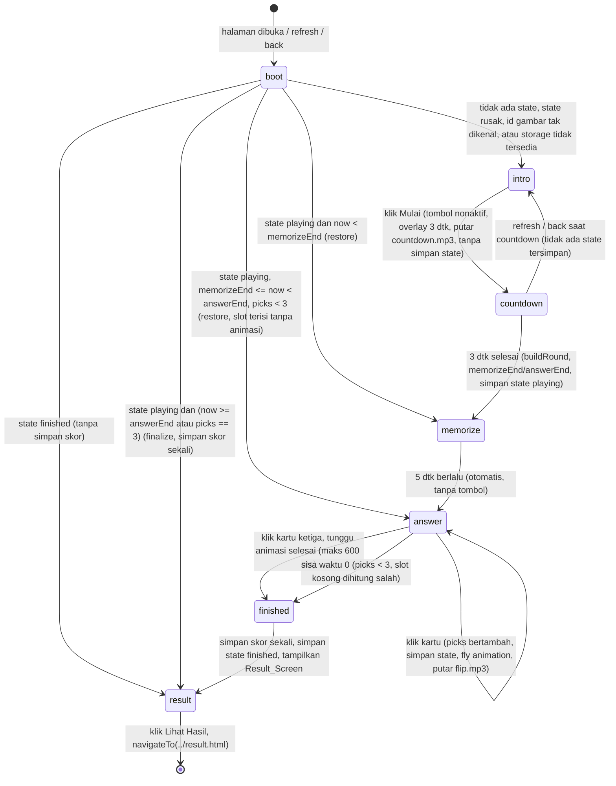
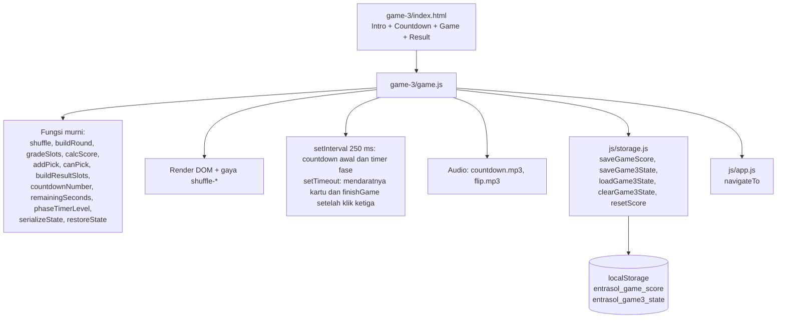

# Dokumen Desain: Memory Shuffle & Recall Game

## Overview

Memory Shuffle & Recall adalah game ketiga dari rangkaian tiga mini-game Entrasol. Halaman `game-3/index.html` berisi **tiga tampilan utama dalam satu file** (hanya satu yang terlihat pada satu waktu) ditambah satu overlay sementara, Countdown_Screen, yang tampil di depan Game_Screen:

- **Intro_Screen** (`#introScreen`): teks "GAME 03", ikon game, judul `h1` "Memory Shuffle & Recall", sub judul, Instruction_Box berisi dua paragraf petunjuk dan Time_Alert (dua keterangan waktu), tombol "Mulai".
- **Countdown_Screen** (`#countdownScreen`): overlay penuh di dalam `main.shuffle-page` yang menutupi Game_Screen selama 3 detik setelah "Mulai" ditekan, menampilkan "Bersiap..." dan angka besar 3, 2, 1. Di belakang overlay hanya ada bingkai kosong. Round baru dipilih setelah countdown selesai. Tidak memakai heading dan tidak pernah disimpan sebagai sesi.
- **Game_Screen** (`#gameScreen`): Screen_Icon (`img.shuffle-screen-icon`, `../assets/icon-game-3.svg`), `h2` "Memory Shuffle & Recall", Phase_Badge (`#phaseBadge`), timer (`#timerBox` berisi ikon `../assets/clock.svg` di kiri angka `#timerText`), progress bar (`#timerBar`), baris Slot (`#slots`, hanya pada Fase_Menyusun), teks arahan (`#prompt`), dan baris kartu (`#cards`).
- **Result_Screen** (`#resultScreen`): Screen_Icon, `h2` "Memory Shuffle & Recall", tiga Result_Slot (gambar + ikon benar/salah), skor besar (0 sampai 30) dengan keterangan "point" dan "dari 30", tombol "Lihat Hasil" (`#continueBtn`) menuju `../result.html`.

Pemain melihat tiga kartu dalam Original_Order selama 5 detik (Fase_Mengingat). Setelah itu halaman beralih otomatis ke Fase_Menyusun selama 5 detik: tiga Slot bernomor di atas, tiga Option_Card dalam Option_Order (selalu berbeda dari Original_Order) di bawah. Pemain mengklik kartu satu per satu, dan setiap kartu terbang ke Slot berikutnya tanpa bisa dibatalkan. Penilaian per Slot: 10 point untuk setiap Slot yang berisi kartu pada urutan yang benar (maksimal 30). Skor ditulis ke LocalStorage (`memorize`) lewat `js/storage.js` tepat satu kali, lalu Result_Screen ditampilkan di halaman yang sama. Tidak ada navigasi otomatis: pindah ke `result.html` hanya saat pemain menekan "Lihat Hasil".

Alur tampilan: **Intro_Screen → Countdown_Screen → Game_Screen (Fase_Mengingat → Fase_Menyusun) → Result_Screen → `result.html`**.

State sesi disimpan di key `entrasol_game3_state` saat permainan dimulai (setelah countdown) dan diperbarui pada setiap klik kartu. Refresh atau tombol back tidak mengulang permainan: ronde berjalan dilanjutkan berdasarkan waktu absolut (`memorizeEnd`, `answerEnd`), dan permainan selesai langsung menampilkan Result_Screen. Refresh saat Countdown_Screen kembali ke Intro_Screen karena belum ada state tersimpan.

Tema visual cyan lembut: body `rgba(0,188,212,0.15)` lewat kelas `shuffle-body`; container `main.shuffle-page` 430px dengan gradasi putih ke `rgba(0,188,212,0.35)`, tanpa wave `assets/background-wave.svg` (berbeda dari game-1 dan game-2). Tombol utama memakai kelas `btn btn-entrasol` (biru tua, teks putih) seperti game-1 dan game-2 yang sudah ada.

### Keputusan Desain Utama

| Keputusan | Alasan |
|-----------|--------|
| Logika dibagi menjadi **fungsi murni** (`shuffle`, `buildRound`, `gradeSlots`, `calcScore`, `addPick`, `canPick`, `buildResultSlots`, `countdownNumber`, `remainingSeconds`, `phaseTimerLevel`, `serializeState`, `restoreState`) dan **lapisan DOM/timer/audio** yang tipis | Fungsi murni mudah diuji, termasuk dengan property-based testing tanpa DOM. Pola yang sama dengan game-2 |
| **Tiga kategori tetap** (`zaitun`, `product`, `organ`), satu gambar per kategori per Round | Tiga kartu selalu unik dan berbeda kategori (A2). Menambah gambar = menambah satu entri `CARD_IMAGES` (Req 4.6) |
| `optionOrder` dipilih acak dari **5 permutasi non-identitas** dari `originalOrder` | Menjamin Option_Order berbeda dari Original_Order tanpa loop acak yang bisa tidak berhenti (Req 4.4, A3) |
| Skor dihitung **per Slot** dari `originalOrder` dan `picks`; Slot kosong dihitung salah | Skor akhir dapat dihitung dari data tersimpan tanpa state tambahan (Req 7, A4) |
| `picks` disimpan **dalam urutan klik**; `picks[i]` mengisi Slot `i+1`. Nomor Slot ditetapkan **saat klik terjadi**, bukan saat animasi selesai | Klik beruntun cepat tidak menimbulkan Slot ganda atau terlewat (Req 6.9) |
| Fly_Animation memakai **transform CSS** dengan selisih `getBoundingClientRect` antara Option_Card dan Slot; kartu asal tetap menempati ruangnya (`visibility: hidden` setelah mendarat) | Tata letak baris Option_Card tidak bergeser saat kartu terbang. Tidak ada library animasi |
| Pada klik ketiga, pemain **dikunci** (`locked = true`) dan `finishGame()` dijadwalkan setelah `FINISH_DELAY_MS = 450` (250 ms bila reduced-motion) | Result_Screen tampil setelah animasi ketiga selesai, maksimal 600 ms setelah klik (Req 6.10, 11.11) |
| `restoreState` memperlakukan state `playing` dengan **`picks.length === 3`** sebagai sudah selesai (`needsFinalize: true`) | Refresh pada jeda animasi ketiga tidak membuat pemain terjebak di Fase_Menyusun tanpa kartu tersisa (Req 10.7) |
| Start dipecah menjadi `beginCountdown()` lalu `startGame()` | Pemain mendapat jeda 3 detik tanpa memotong waktu 5+5 detik |
| **Round dan batas waktu dihitung di `startGame()` setelah countdown** (`memorizeEnd = now + 5000`, `answerEnd = memorizeEnd + 5000`) | Kartu tidak terlihat sebelum waktunya (Req 3.1, 3.7) |
| **Tidak ada Game_Session_State yang disimpan selama phase `countdown`** | Refresh atau back saat countdown menghasilkan sesi baru (Req 3.6, 10.10) |
| **Waktu absolut** disimpan di state; sisa waktu dihitung ulang dari `Date.now()` | Refresh tidak mengulang fase dan waktu saat halaman tertutup tetap terhitung (Req 10.5-10.7) |
| Interval ~250 ms yang merender hanya saat sisa detik berubah | Pergantian detik tepat walau interval tertahan |
| State sesi di **key terpisah** `entrasol_game3_state` | Skema skor tetap sesuai aturan workspace |
| Result_Screen di **halaman yang sama** lewat atribut `hidden`, **tanpa `pushState`** | Tombol back kembali ke halaman sebelumnya (Req 8.1, 10.11, 10.12) |
| `finishGame` dijaga flag `finished` dan menyimpan skor tepat sekali; reload dengan fase `finished` tidak menyimpan ulang | Skor tidak ganda (Req 9.1, 10.8) |
| Audio: `countdown.mp3` di Countdown_Screen dan `flip.mp3` pada tiap klik kartu; `playSound` tidak pernah melempar | Autoplay diblokir tidak boleh mengganggu permainan (Req 3.9, A5) |
| `--shuffle-card` dibatasi lebar **dan** tinggi layar | Tiga kartu + jarak 4px muat satu baris pada 320px, dan dua baris kartu + header muat di 550px (Req 5.3, 11.4) |
| Validasi `isValidGame3State` di `storage.js` memeriksa struktur dan konsistensi skor, sedangkan pemeriksaan id terhadap `CARD_IMAGES` dilakukan di `game.js` | `storage.js` tetap tidak bergantung pada daftar gambar milik game |

### Catatan Riset

Tidak ada kebutuhan riset eksternal. Desain memakai API browser standar (`localStorage`, `Date.now`, `setInterval`, `setTimeout`, `Audio`, `matchMedia('(prefers-reduced-motion: reduce)')`, `getBoundingClientRect`, CSS `transform`/`transition`, `aspect-ratio`, `clamp()`, `min()`, atribut `hidden`) dan aset yang sudah ada: `game-3/assets/zaitun/zaitun-1..3.jpg`, `product/product-1..10.jpg`, `organ/organ-1..3.jpg`, `checked.png`, `wrong.png`, `audio/flip.mp3`, `audio/countdown.mp3`, `assets/icon-game-3.svg`, `assets/clock.svg`, dan font Noto Sans lokal. Pola arsitektur mengikuti game-2 (`memory-recall-game`): urutan berkas `game.js`, bentuk `serializeState`/`restoreState`, dan aturan fit-to-viewport. Teks `alt` kartu pada `CARD_IMAGES` bersifat sementara ("Gambar zaitun 1", dst.) dan dapat diperjelas setelah isi gambar final diketahui, tanpa mengubah logika.

## Architecture

### Struktur Berkas

```
kiro/
├── index.html            # Home (tidak berubah)
├── result.html           # Halaman hasil (tidak berubah; membaca field memorize)
├── css/style.css         # + blok gaya Memory Shuffle & Recall (prefix .shuffle-, body.shuffle-body)
├── js/
│   ├── storage.js        # + GAME3_STATE_KEY dan fungsi state game-3; resetScore ikut menghapus state game-3
│   └── app.js            # navigateTo(url) (tidak berubah)
├── game-3/
│   ├── index.html        # Intro + Countdown + Game + Result Screen (baru)
│   ├── game.js           # CARD_IMAGES, fungsi murni, state runtime, lapisan DOM/timer/audio (baru)
│   └── assets/           # zaitun/, product/, organ/, checked.png, wrong.png, audio/{flip,countdown}.mp3 (sudah ada)
└── tests/                # (dibuat saat tugas pengujian) property + unit test, hanya alat pengembang
```

### Alur Halaman (State Diagram)



`finished` adalah phase internal sesaat; hasilnya selalu Result_Screen. Tidak ada transisi otomatis keluar dari `result`.

### Lapisan Modul



### Urutan Pemuatan Skrip

Di `game-3/index.html`: `../vendor/bootstrap/bootstrap.bundle.min.js`, `../js/storage.js`, `../js/app.js`, `game.js`. Semua path relatif dan lokal (Req 11.7, 11.8).

## Components and Interfaces

### 1. `js/storage.js` (tambahan)

Tetap menjadi satu-satunya berkas yang menyentuh `localStorage` (Req 9.5).

```js
const GAME3_STATE_KEY = 'entrasol_game3_state';

// Validasi ketat, murni (tanpa localStorage), diekspos untuk pengujian.
function isValidGame3State(obj) { /* lihat tabel aturan */ }

// Simpan state; return { ok: boolean }. Tidak melempar: kegagalan tulis -> ok:false.
function saveGame3State(stateObj) { /* JSON.stringify -> setItem(GAME3_STATE_KEY) */ }

// Baca state; objek valid atau null bila tidak ada / JSON rusak / tidak valid / storage error.
function loadGame3State() { /* getItem -> JSON.parse -> isValidGame3State ? obj : null */ }

// Hapus state; tidak melempar.
function clearGame3State() { /* removeItem(GAME3_STATE_KEY) */ }

// resetScore (diubah): setItem(SCORE_KEY, DEFAULT) + clearGame1State() + clearGame2State() + clearGame3State()
```

**Aturan validasi `isValidGame3State`** (semua harus terpenuhi, selain itu `loadGame3State` mengembalikan `null`):

| Field | Aturan |
|-------|--------|
| objek | bukan `null`, bukan array |
| `phase` | tepat `'playing'` atau `'finished'` |
| `originalOrder` | array 3 string tidak kosong, semuanya unik |
| `optionOrder` | array 3 string yang merupakan permutasi dari `originalOrder` dan **tidak identik** dengan `originalOrder` |
| `memorizeEnd`, `answerEnd` | angka finite dan `answerEnd > memorizeEnd` |
| `picks` | array 0 sampai 3 string unik, setiap elemen ada di `originalOrder` |
| `score` | bila `finished`: bilangan bulat sama dengan `10 × jumlah indeks i dengan picks[i] === originalOrder[i]`; bila `playing`: diabaikan |

Validasi `score` memakai rumus yang sama dengan `calcScore` (ditulis ulang di `storage.js` supaya tidak bergantung pada `game.js`). `resetScore` yang ikut menghapus state game-3 memastikan sesi baru dari Home selalu bersih (Req 10.1, 12.2). Fungsi baru diekspos lewat objek global dan `module.exports`, mengikuti pola game-1 dan game-2.

### 2. `js/app.js`

```js
function navigateTo(url) { window.location.href = url; }
```

Tidak berubah. `game-3/game.js` memanggilnya hanya dari `#continueBtn`.

### 3. `game-3/game.js`

Konstanta:

```js
const MEMORIZE_SECONDS = 5;
const ANSWER_SECONDS = 5;
const PRE_COUNTDOWN_SECONDS = 3;
const TICK_INTERVAL_MS = 250;
const WARNING_THRESHOLD = 2;
const POINTS_PER_SLOT = 10;
const SLOT_COUNT = 3;
const FLY_MS = 400;               // Fly_Animation (Req 6.7)
const FINISH_DELAY_MS = 450;      // jeda klik ketiga -> Result_Screen (<= 600 ms)
const FINISH_DELAY_REDUCED_MS = 250;
const CATEGORIES = ['zaitun', 'product', 'organ'];
const NEXT_PAGE = '../result.html';

// Satu-satunya daftar gambar (Req 4.1). Menambah gambar = menambah satu entri.
const CARD_IMAGES = [
  { id: 'zaitun-1', category: 'zaitun', src: 'assets/zaitun/zaitun-1.jpg', alt: 'Gambar zaitun 1' },
  { id: 'zaitun-2', category: 'zaitun', src: 'assets/zaitun/zaitun-2.jpg', alt: 'Gambar zaitun 2' },
  { id: 'zaitun-3', category: 'zaitun', src: 'assets/zaitun/zaitun-3.jpg', alt: 'Gambar zaitun 3' },
  { id: 'product-1', category: 'product', src: 'assets/product/product-1.jpg', alt: 'Gambar produk 1' },
  // ... product-2 sampai product-10 dengan pola yang sama
  { id: 'organ-1', category: 'organ', src: 'assets/organ/organ-1.jpg', alt: 'Gambar organ 1' },
  { id: 'organ-2', category: 'organ', src: 'assets/organ/organ-2.jpg', alt: 'Gambar organ 2' },
  { id: 'organ-3', category: 'organ', src: 'assets/organ/organ-3.jpg', alt: 'Gambar organ 3' }
];
```

**Fungsi murni** (tanpa DOM dan tanpa localStorage; diekspos lewat `MemoryShuffleLogic` dan `module.exports` bila tersedia):

| Fungsi | Tanda tangan | Perilaku |
|--------|--------------|----------|
| `shuffle(arr, rand = Math.random)` | `(Array, fn) => Array` | Fisher-Yates, mengembalikan salinan baru |
| `buildRound(images, rand = Math.random)` | `(Array, fn) => {originalOrder, optionOrder} \| null` | Lihat algoritma di bawah |
| `gradeSlots(originalOrder, picks)` | `=> boolean[3]` | Elemen ke-i `true` bila `picks[i]` ada dan `=== originalOrder[i]` |
| `calcScore(originalOrder, picks)` | `=> 0 \| 10 \| 20 \| 30` | `10 × jumlah true` dari `gradeSlots` |
| `addPick(picks, optionOrder, id)` | `=> string[]` | Mengembalikan `picks` baru dengan `id` di akhir bila `id` ada di `optionOrder`, belum ada di `picks`, dan `picks.length < 3`; selain itu mengembalikan salinan `picks` tanpa perubahan. Tidak mengubah argumen |
| `canPick(gameState)` | `=> boolean` | `true` hanya bila `phase === 'answer'`, `finished === false`, `locked === false`, dan `picks.length < 3` |
| `buildResultSlots(originalOrder, picks)` | `=> ResultSlot[3]` | Lihat di bawah |
| `countdownNumber(elapsedMs)` | `=> 3 \| 2 \| 1 \| 0` | `< 1000` → 3, `< 2000` → 2, `< 3000` → 1, `>= 3000` → 0 (selesai); negatif atau non-finite → 3 |
| `remainingSeconds(endTime, now, maxSeconds = 5)` | `=> integer 0..5` | `clamp(ceil((endTime - now) / 1000), 0, maxSeconds)` |
| `phaseTimerLevel(secondsLeft)` | `=> 'normal' \| 'warning'` | `warning` bila `0 < s <= 2` |
| `serializeState(gameState, phase)` | `=> Game_Session_State` | Membentuk `{ phase, originalOrder, optionOrder, memorizeEnd, answerEnd, picks }`; bila `phase === 'finished'` menambah `score = calcScore(originalOrder, picks)` |
| `restoreState(saved, now)` | `=> RestoreResult` | Menentukan mode boot (lihat di bawah) |

**Algoritma `buildRound(images, rand)`:**

1. Untuk setiap kategori di `CATEGORIES`, kumpulkan gambar ber-`category` tersebut. Bila ada kategori tanpa entri (atau `images` bukan array), kembalikan `null`.
2. Pilih satu gambar acak dari tiap kategori memakai `randomIndex(n, rand)` (aman terhadap nilai `rand` di luar 0..1).
3. `originalOrder = shuffle([zaitunId, productId, organId], rand)`.
4. Bentuk lima permutasi indeks non-identitas dari `[0, 1, 2]` (`[0,2,1]`, `[1,0,2]`, `[1,2,0]`, `[2,0,1]`, `[2,1,0]`), pilih satu secara acak, lalu `optionOrder = permutasi.map(i => originalOrder[i])`.
5. Kembalikan `{ originalOrder, optionOrder }`. Array `images` tidak diubah.

Hasilnya selalu tiga id unik dari tiga kategori berbeda, dan `optionOrder` tidak identik dengan `originalOrder`. Dengan 3×10×3 = 90 kombinasi gambar, 6 urutan asli, dan 5 urutan pilihan, ada **2700 kemungkinan Round**.

**Bentuk `ResultSlot` dari `buildResultSlots(originalOrder, picks)`:**

```js
// ke-i (0..2)
{ slot: i + 1, imageId: picks[i] ?? null, status: 'correct' | 'wrong' | 'empty',
  icon: { src: 'assets/checked.png', alt: 'Posisi benar' }          // correct
      | { src: 'assets/wrong.png',   alt: 'Posisi salah' }          // wrong
      | { src: 'assets/wrong.png',   alt: 'Posisi tidak terisi' } } // empty
```

`status` adalah `'empty'` bila `picks[i]` tidak ada, `'correct'` bila `gradeSlots(...)[i]` bernilai `true`, selain itu `'wrong'`.

**Hasil `restoreState(saved, now)`:**

```js
// saved = null atau Game_Session_State valid (hasil loadGame3State)
{ mode: 'intro' }                                                     // saved === null
{ mode: 'result', originalOrder, picks, score, needsFinalize: false } // saved.phase === 'finished'
{ mode: 'result', originalOrder, picks, score: calcScore(originalOrder, picks),
  needsFinalize: true }                                               // playing dan (now >= answerEnd atau picks.length === 3)
{ mode: 'playing', stage: 'memorize', originalOrder, optionOrder, picks: [],
  memorizeEnd, answerEnd,
  secondsLeft: remainingSeconds(memorizeEnd, now) }                   // playing dan now < memorizeEnd
{ mode: 'playing', stage: 'answer', originalOrder, optionOrder, picks,
  memorizeEnd, answerEnd,
  secondsLeft: remainingSeconds(answerEnd, now) }                     // playing, memorizeEnd <= now < answerEnd, picks < 3
```

`restoreState` tidak membaca storage dan tidak menyentuh DOM. Urutan pengecekan: `null`, `finished`, lalu (`now >= answerEnd` atau `picks.length === 3`), lalu `now < memorizeEnd`, selain itu `answer`.

**State runtime:**

```js
const state = {
  phase: 'intro',        // 'intro' | 'countdown' | 'memorize' | 'answer' | 'finished'
  round: null,           // { originalOrder, optionOrder }
  picks: [],             // id kartu menurut urutan klik; picks[i] mengisi Slot i+1
  memorizeEnd: 0,        // timestamp ms absolut
  answerEnd: 0,
  secondsLeft: MEMORIZE_SECONDS,
  timerId: null,
  countdownId: null,     // interval countdown awal (null bila tidak aktif)
  pendingTimeouts: [],   // id setTimeout animasi dan finish yang tertunda
  locked: false,         // true setelah klik ketiga
  finished: false        // penjaga satu kali simpan skor
};
```

**Audio:**

```js
const sounds = { countdown: null, flip: null };
try {
  if (typeof Audio !== 'undefined') {
    sounds.countdown = new Audio('assets/audio/countdown.mp3');
    sounds.flip = new Audio('assets/audio/flip.mp3');
  }
} catch (e) {}

function playSound(name) { /* currentTime = 0; play(); Promise ditolak ditangkap; tidak melempar */ }
function stopSound(name)  { /* pause(); currentTime = 0; tidak melempar */ }
```

`playSound('countdown')` dipanggil tepat sekali di `beginCountdown()`; `stopSound('countdown')` dipanggil oleh `cancelCountdown()`. `playSound('flip')` dipanggil di `onOptionClick` untuk klik yang diterima. Tidak ada pemutaran countdown di Game_Screen atau saat restore (Req 3.10).

**Fungsi berefek samping (lapisan DOM):**

- `init()` — memanggil `restoreState(loadGame3State(), Date.now())`:
  - `intro`: bila `buildRound(CARD_IMAGES, Math.random)` bernilai `null`, tombol `#startBtn` dinonaktifkan; selain itu bind Mulai ke `beginCountdown` dan daftarkan `pagehide` → `cancelCountdown`.
  - `playing`: bila `originalOrder`/`optionOrder` memuat id yang tidak ada di `CARD_IMAGES`, atau ketiga id tidak mewakili tiga kategori berbeda → `clearGame3State()` lalu perilaku `intro`. Selain itu set `state.round`, `picks`, `memorizeEnd`, `answerEnd`, tampilkan Game_Screen pada stage `memorize` atau `answer` (Slot terisi langsung tanpa animasi), jalankan `startTimer()`. Countdown_Screen tetap tersembunyi.
  - `result`: bila `needsFinalize`, panggil `saveGameScore('memorize', score)` tepat sekali dan `saveGame3State(serializeState(..., 'finished'))`, lalu `showResult`. Bila sudah `finished`, langsung `showResult` tanpa menyimpan skor.
  - `#continueBtn` di-bind pada semua mode ke `navigateTo(NEXT_PAGE)`.
- `beginCountdown()` — dijaga `phase === 'intro'`. Menonaktifkan Mulai, `phase = 'countdown'`, menyembunyikan Intro_Screen, menampilkan Game_Screen dengan `renderEmptyStage()` (bingkai kosong tanpa gambar), menampilkan `#countdownScreen`, `playSound('countdown')` sekali, lalu interval yang menghitung `countdownNumber(Date.now() - t0)` dan memperbarui `#countdownNumber` hanya saat angka berubah. Saat hasilnya 0: bersihkan interval, sembunyikan overlay, panggil `startGame()`. Tidak memanggil `saveGame3State`.
- `cancelCountdown()` — pada `pagehide`: bila `countdownId !== null`, `clearInterval`, `countdownId = null`, `stopSound('countdown')`.
- `startGame()` — dijaga `phase === 'countdown'`: `round = buildRound(CARD_IMAGES, Math.random)`; `picks = []`; `memorizeEnd = Date.now() + 5000`; `answerEnd = memorizeEnd + 5000`; `saveGame3State(serializeState(state, 'playing'))`; `enterMemorize()`; `startTimer()`.
- `enterMemorize()` — set phase, `renderMemorize()` (badge "Hafalkan!", prompt "Perhatikan gambar berikut dan urutannya", tiga kartu dalam `originalOrder` masing-masing dibungkus `div.shuffle-memo` dengan angka urutan 1, 2, 3 (`span.shuffle-memo__num`) di bawah kotak, `#slots` disembunyikan), lalu `renderTimer(true)`.
- `enterAnswer(restoredPicks)` — set phase, `renderAnswer()` (badge "Jawab sekarang!", tiga Slot kosong, prompt "Pilih gambar dengan urutan yang tepat", tiga `button.shuffle-option` dalam `optionOrder`), lalu `renderTimer(true)` sehingga progress bar langsung 100% tanpa animasi pelebaran. Untuk setiap id di `restoredPicks`, Slot diisi langsung dan Option_Card terkait diberi `disabled` dan kelas `shuffle-option--used` (tanpa animasi).
- `startTimer()` / `tick()` — interval 250 ms. `tick` menghitung sisa detik dari batas waktu fase aktif dengan `remainingSeconds` dan merender hanya saat nilai berubah. Bila `now >= memorizeEnd` pada phase `memorize` → `enterAnswer([])`. Bila `now >= answerEnd` → `finishGame()`.
- `onOptionClick(id)` — abaikan bila `!canPick(state)`. Selain itu, secara sinkron: `state.picks = addPick(state.picks, round.optionOrder, id)` (abaikan bila tidak berubah), `slotIndex = picks.length - 1`, tombol `disabled`, `playSound('flip')`, `saveGame3State(serializeState(state, 'playing'))`, lalu `flyToSlot(button, slotIndex)`. Bila `picks.length === 3`: `state.locked = true` dan jadwalkan `finishGame()` setelah `FINISH_DELAY_MS` (atau `FINISH_DELAY_REDUCED_MS`).
- `flyToSlot(button, slotIndex)` — membaca `getBoundingClientRect()` tombol dan Slot tujuan, menerapkan `transform: translate(dx, dy)` dengan `transition: transform 0.4s ease` dan z-index di atas Slot. Setelah `FLY_MS`, gambar disalin ke Slot (kelas `shuffle-slot--filled`) dan tombol diberi `shuffle-option--used` (`visibility: hidden`, transform direset tanpa transisi). Bila `prefers-reduced-motion: reduce`, Slot diisi langsung tanpa transform. Karena `slotIndex` ditetapkan saat klik, beberapa animasi dapat berjalan bersamaan tanpa saling menimpa.
- `finishGame()` — dijaga `state.finished`. Selain itu: `finished = true`, `phase = 'finished'`, `clearInterval(timerId)`, bersihkan `pendingTimeouts`, `score = calcScore(originalOrder, picks)`, `saveGameScore('memorize', score)` tepat sekali (dibungkus `try/catch`), `saveGame3State(serializeState(state, 'finished'))` (hasil `ok:false` diabaikan), lalu `showResult(...)`. Tidak ada `setTimeout` navigasi.
- `showResult(originalOrder, picks, score)` — mengisi tiga `.shuffle-result-slot` dari `buildResultSlots` (gambar atau kotak kosong bernomor, plus ikon dan `alt`) dan `#resultScore`, menyembunyikan Intro/Game/Countdown, menampilkan Result. Tanpa `history.pushState`.
- `renderEmptyStage()`, `renderMemorize()`, `renderAnswer()`, `renderTimer(instant)` — pembaruan DOM. `renderTimer` mengubah angka `#timerText`, kelas peringatan pada `#timerBox`, dan lebar `#timerBar`; bila `instant` true, transisi `#timerBar` dimatikan sementara (`style.transition = 'none'`, set lebar, paksa reflow, kembalikan transisi) agar bar tidak beranimasi saat fase berganti. `init()` dipanggil pada `DOMContentLoaded` hanya bila `document` tersedia.

### 4. Markup `game-3/index.html`

```html
<body class="shuffle-body">
<main class="shuffle-page">
  <section id="introScreen" class="shuffle-intro">
    <p class="shuffle-eyebrow">GAME 03</p>
    
    <h1 class="shuffle-title">Memory Shuffle &amp; Recall</h1>
    <p class="shuffle-subtitle">Ingat posisi kartu dan susun kembali urutannya!</p>
    <div class="shuffle-instruction">
      <p>Amati dan ingat urutan 3 kartu yang ditampilkan selama 5 detik.</p>
      <p>Setelah itu, kartu akan diacak secara otomatis. Susun kembali ketiga kartu sesuai urutan semula dalam waktu 5 detik!</p>
      <div class="shuffle-time-alert" role="note">
        <span>Waktu mengingat gambar: 5 detik</span>
        <span>Waktu memilih gambar: 5 detik</span>
      </div>
    </div>
    <button type="button" id="startBtn" class="btn btn-entrasol">Mulai</button>
  </section>

  <section id="countdownScreen" class="shuffle-countdown" hidden>
    <p class="shuffle-countdown__label">Bersiap...</p>
    <div id="countdownNumber" class="shuffle-countdown__number" role="status" aria-live="assertive">3</div>
  </section>

  <section id="gameScreen" class="shuffle-game" hidden>
    
    <h2 class="shuffle-game-title">Memory Shuffle &amp; Recall</h2>
    <span id="phaseBadge" class="shuffle-badge shuffle-badge--memorize">Hafalkan!</span>
    <span id="timerBox" class="shuffle-timer"><span id="timerText" aria-live="off">5</span></span>
    <div class="progress shuffle-progress" role="progressbar" aria-label="Sisa waktu" aria-valuemin="0" aria-valuemax="5" aria-valuenow="5">
      <div id="timerBar" class="progress-bar"></div>
    </div>
    <div id="slots" class="shuffle-slots" hidden></div>
    <p id="prompt" class="shuffle-prompt">Perhatikan gambar berikut dan urutannya</p>
    <div id="cards" class="shuffle-cards"></div>
  </section>

  <section id="resultScreen" class="shuffle-result" hidden>
    
    <h2 class="shuffle-result__title">Memory Shuffle &amp; Recall</h2>
    <div id="resultSlots" class="shuffle-result__slots"></div>
    <p class="shuffle-result__score">
      <span id="resultScore" class="shuffle-result__number">0</span>
      <span class="shuffle-result__unit">point</span>
      <span class="shuffle-result__max">dari 30</span>
    </p>
    <button type="button" id="continueBtn" class="btn btn-entrasol">Lihat Hasil</button>
  </section>
</main>

<script src="../vendor/bootstrap/bootstrap.bundle.min.js"></script>
<script src="../js/storage.js"></script>
<script src="../js/app.js"></script>
<script src="game.js"></script>
</body>
```

`section#countdownScreen` berada di dalam `main.shuffle-page` agar overlay hanya menutupi container 430px, tanpa heading. Angka berada di elemen ber-`role="status"` dan `aria-live="assertive"`. Heading: satu `h1` (Intro_Screen), `h2` untuk Game_Screen dan Result_Screen (Req 11.9).

Isi area kartu dirender oleh JavaScript:

```html
<!-- Fase_Mengingat: #slots hidden, #cards berisi tiga bingkai dalam originalOrder, masing-masing dengan angka urutan di bawahnya -->
<div class="shuffle-memo">
  <div class="shuffle-frame"></div>
  <span class="shuffle-memo__num">1</span>
</div>
<!-- ... dua bingkai lain dengan angka 2 dan 3 -->

<!-- Fase_Menyusun: #slots -->
<div class="shuffle-slot" data-slot="1"><span class="shuffle-slot__num">1</span></div>
<div class="shuffle-slot" data-slot="2"><span class="shuffle-slot__num">2</span></div>
<div class="shuffle-slot" data-slot="3"><span class="shuffle-slot__num">3</span></div>

<!-- Fase_Menyusun: #cards -->
<button type="button" class="shuffle-option" data-id="product-4" aria-label="Pilih gambar: Gambar produk 4">
  
</button>
<!-- ... dua tombol lain -->

<!-- Result_Slot -->
<div class="shuffle-result-slot">
  <div class="shuffle-frame"></div>
  
</div>
<!-- Slot kosong: <div class="shuffle-frame shuffle-frame--empty">2</div> + wrong.png alt "Posisi tidak terisi" -->
```

Path `assets/...` relatif terhadap `game-3/`, sama seperti game-2.

### 5. Gaya CSS (tambahan di `css/style.css`)

Memakai variabel yang sudah ada (`--entrasol-blue-dark`, `--entrasol-blue-light`, `--entrasol-green`, `--entrasol-white`, `--app-max-width`, `--dvh`). Hanya menambah kelas berprefix `shuffle-`; Home, `flip-`, dan `recall-` tidak diubah (Req 2.9).

- `body.shuffle-body` — `background-color: rgba(0, 188, 212, 0.15)`.
- `.shuffle-page` — `max-width: var(--app-max-width); margin: 0 auto; position: relative; overflow: hidden`; latar `linear-gradient(180deg, #FFFFFF 0%, rgba(0, 188, 212, 0.35) 100%)`; tanpa `::after` dan tanpa `assets/background-wave.svg`.
- `.shuffle-intro`, `.shuffle-eyebrow`, `.shuffle-icon`, `.shuffle-title`, `.shuffle-subtitle` — kolom terpusat, teks Biru_Tua.
- `.shuffle-instruction` — latar putih, `border: 2px solid` (Biru_Muda), radius ≥ 8px, bayangan halus.
- `.shuffle-time-alert` — lebar 100%, teks Biru_Tua, latar putih transparan terang, border tipis, radius `0.5rem` (bukan pill), dua baris (`display: flex; flex-direction: column`).
- Tombol "Mulai" dan "Lihat Hasil" memakai `btn btn-entrasol` yang sudah ada, dengan `min-height: 48px` dan `min-width: 44px`.
- `.shuffle-countdown` — overlay `position: absolute; inset: 0; z-index: 3; display: flex; flex-direction: column; align-items: center; justify-content: center; background: rgba(255, 255, 255, 0.85)`; `__label` Biru_Tua tebal; `__number` `font-size: 8rem; font-weight: 700; line-height: 1` dengan animasi pulse yang dimatikan pada `@media (prefers-reduced-motion: reduce)` (Req 11.11).
- `.shuffle-game` — kolom terpusat dengan `--shuffle-card: min(calc((100% - 8px) / 3), 220px)`; `.shuffle-badge--memorize` latar Biru_Muda + teks Biru_Tua; `.shuffle-badge--answer` latar Biru_Tua + teks putih (fase dibedakan lewat teks dan warna, Req 11.10); `.shuffle-screen-icon` (Screen_Icon di atas Game_Screen dan Result_Screen, tinggi 56px, `margin: 0 auto`, `object-fit: contain`); `.shuffle-timer` (pill `inline-flex`) dengan `.shuffle-timer__icon` (ikon jam `1em × 1em`, `margin-right: 0.4em`, sama seperti `recall-timer__icon`) dan `.shuffle-timer--warning` (warna peringatan pada angka dan border); `.shuffle-progress` (isi Biru_Tua); `.shuffle-prompt`.
- Baris kartu: `.shuffle-slots`, `.shuffle-cards`, `.shuffle-result__slots` memakai `display: flex; justify-content: center; gap: 4px; width: 100%`.
- `.shuffle-frame`, `.shuffle-option`, `.shuffle-slot`, dan `.shuffle-result-slot .shuffle-frame` persegi: `box-sizing: border-box; width: var(--shuffle-card); aspect-ratio: 1 / 1; min-width: 44px; min-height: 44px; border-radius: 12px; overflow: hidden`. Bingkai dan Option_Card berborder 2px Biru_Muda, Slot berborder 2px Hijau_Muda (`--entrasol-green`).
- `.shuffle-slot__num` — angka 1, 2, 3 di tengah (`position: absolute; inset: 0; display: flex; align-items: center; justify-content: center; font-weight: 700`), disembunyikan pada `.shuffle-slot--filled`.
- `.shuffle-option` — `cursor: pointer; position: relative; padding: 0`; `:focus-visible` outline 3px Biru_Tua; `:disabled` mempertahankan opasitas (kartu yang sedang terbang tetap terlihat); `.shuffle-option--used { visibility: hidden; }`; `.shuffle-option--flying { z-index: 5; transition: transform 0.4s ease; }`; pada `prefers-reduced-motion: reduce` transisi dihapus.
- `.shuffle-memo` — kolom (`display: flex; flex-direction: column; align-items: center; gap: 4px; width: var(--shuffle-card)`) berisi `.shuffle-frame` (lebar 100%) dan `.shuffle-memo__num` (angka urutan, `font-size: 1.25rem; font-weight: 700`, rata tengah, Biru_Tua). Hanya dipakai pada Fase_Mengingat.
- `.shuffle-img { width: 100%; height: 100%; object-fit: cover; display: block }`.
- Jarak Fase_Menyusun: `.shuffle-slots` ke `.shuffle-prompt` 16px (`margin-top` prompt), `.shuffle-prompt` ke `.shuffle-cards` 8px.
- `.shuffle-result` — kolom terpusat; `__title`, `__slots`, `.shuffle-result-slot` (kolom: bingkai + ikon), `__icon` (ikon kecil sekitar 28px), `__number` (≈ 4.5rem), `__unit`, `__max` (≥ 16px), semua Biru_Tua; tombol berjarak 16px di bawah skor.
- `[hidden]` ditegaskan pada `.shuffle-intro`, `.shuffle-game`, `.shuffle-result`, `.shuffle-countdown`, dan `.shuffle-slots` karena `display` eksplisit mengalahkan atribut `hidden`.
- Mobile-first; teks isi minimal 16px; tanpa scroll horizontal pada 320px sampai 1920px; tanpa utility spasi Bootstrap `!important` pada elemen yang harus mengecil (Req 11.5, 11.6).

**Aturan fit-to-viewport** (di dalam `@media (min-height: 550px)` yang sudah ada):

- `html, body { height: 100%; overflow: hidden; }`.
- `.shuffle-page { height: calc(100 * var(--dvh)); min-height: 0; overflow-x: hidden; overflow-y: auto; padding: calc(2 * var(--dvh)) 1rem; }` (`overflow-y: auto` hanya jaring pengaman).
- `.shuffle-intro`, `.shuffle-game`, `.shuffle-result { flex: 1 1 auto; min-height: 0; justify-content: center; justify-content: safe center; }`.
- `.shuffle-game, .shuffle-result { --shuffle-card: min(calc((100% - 8px) / 3), 220px, calc((100 * var(--dvh) - 290px) / 2)); }`.
- Ukuran font, ikon, badge, timer, jarak, dan ikon hasil memakai `clamp(min, calc(N * var(--dvh)), max)` dengan `max` = ukuran desain penuh; Screen_Icon `clamp(32px, calc(6.5 * var(--dvh)), 56px)`; angka urutan `.shuffle-memo__num` `clamp(1rem, calc(3 * var(--dvh)), 1.25rem)`; angka countdown `clamp(5rem, calc(20 * var(--dvh)), 8rem)`.
- Di luar media query (tinggi < 550px) container memakai `min-height: 100svh` dan halaman boleh scroll (Req 11.2).

**Anggaran tinggi Fase_Menyusun** (viewport 375×553): total = 2 × `--shuffle-card` + overhead. Overhead terdiri dari padding container atas-bawah (≈ 22px), Screen_Icon (≈ 36px pada 553px), judul `h2` (≈ 26px), Phase_Badge (≈ 28px), angka timer (≈ 36px), progress bar (10px), jarak Slot ke teks (16px), teks arahan (≈ 22px), jarak teks ke kartu (8px), dan celah antar elemen (≈ 41px), total ≈ 245px; pada Fase_Mengingat angka urutan (≈ 21px) menggantikan baris Slot. Dipakai 290px untuk cadangan. Pada 553px batas tinggi adalah `(553 − 290) / 2 ≈ 131px`, sedangkan batas lebar pada 375px adalah `(375 − 24 − 8) / 3 ≈ 114px`, sehingga dua baris kartu (≈ 228px) + overhead (≈ 245px) = ≈ 473px muat dengan sisa. Batas tinggi baru menentukan pada layar lebar dan pendek. Pada Fly_Animation, kartu bergerak hanya di dalam container sehingga tidak menambah scroll vertikal maupun horizontal (Req 11.1, 11.5).

## Data Models

### Skor di LocalStorage (key `entrasol_game_score`)

```json
{ "memoryFlip": 40, "memoryRecall": 30, "memorize": 20, "total": 90 }
```

Invarian: `total = memoryFlip + memoryRecall + memorize`; `memorize` ∈ {0, 10, 20, 30}. Skor 20 hanya mungkin bila waktu habis dengan Slot kosong (A4). Game-3 hanya mengubah `memorize` (Req 9.2, 12.3).

### Game_Session_State (key `entrasol_game3_state`)

Fase `playing` (pemain sudah memilih satu kartu):

```json
{
  "phase": "playing",
  "originalOrder": ["organ-2", "zaitun-1", "product-4"],
  "optionOrder": ["product-4", "organ-2", "zaitun-1"],
  "memorizeEnd": 1760000005000,
  "answerEnd": 1760000010000,
  "picks": ["organ-2"]
}
```

Fase `finished`:

```json
{
  "phase": "finished",
  "originalOrder": ["organ-2", "zaitun-1", "product-4"],
  "optionOrder": ["product-4", "organ-2", "zaitun-1"],
  "memorizeEnd": 1760000005000,
  "answerEnd": 1760000010000,
  "picks": ["organ-2", "zaitun-1", "product-4"],
  "score": 30
}
```

| Field | Tipe | Keterangan |
|-------|------|-----------|
| `phase` | `'playing' \| 'finished'` | Tahap sesi. `intro` dan `countdown` tidak disimpan |
| `originalOrder` | 3 string unik | Urutan kartu pada Fase_Mengingat; jawaban benar |
| `optionOrder` | 3 string | Permutasi `originalOrder`, tidak identik dengan `originalOrder` |
| `memorizeEnd` | angka (ms epoch) | Waktu mulai + 5000 |
| `answerEnd` | angka (ms epoch) | `memorizeEnd + 5000` |
| `picks` | 0 sampai 3 string unik | id kartu menurut urutan klik; `picks[i]` mengisi Slot `i+1` |
| `score` | `0 \| 10 \| 20 \| 30` | Hanya saat `finished`; `10 × jumlah Slot benar` |

### Card_Image dan Round

```js
{ id: 'zaitun-1', category: 'zaitun', src: 'assets/zaitun/zaitun-1.jpg', alt: '...' }   // entri CARD_IMAGES
{ originalOrder: ['organ-2', 'zaitun-1', 'product-4'],
  optionOrder:   ['product-4', 'organ-2', 'zaitun-1'] }                                  // Round
```

### Aturan Transisi State

| Dari | Peristiwa | Ke | Efek penyimpanan |
|------|-----------|----|------------------|
| (boot) | tidak ada / rusak / id tak dikenal | `intro` | state tak dikenal dihapus |
| (boot) | `playing`, now < memorizeEnd | `memorize` | tidak ada |
| (boot) | `playing`, memorizeEnd ≤ now < answerEnd, picks < 3 | `answer` | tidak ada |
| (boot) | `playing`, now ≥ answerEnd atau picks = 3 | `result` | `saveGameScore` sekali + `saveGame3State(finished)` |
| (boot) | `finished` | `result` | tidak ada |
| `intro` | klik Mulai | `countdown` | tidak ada (tanpa state tersimpan) |
| `countdown` | 3 detik selesai | `memorize` | `saveGame3State(playing, picks: [])` |
| `countdown` | halaman ditinggalkan / refresh | (keluar) | tidak ada; kunjungan berikutnya `intro` |
| `memorize` | 5 detik berlalu | `answer` | tidak ada |
| `answer` | klik kartu (picks < 3 setelah klik) | `answer` | `saveGame3State(playing)` dengan `picks` terbaru |
| `answer` | klik kartu ketiga | `finished` → `result` (setelah ≤ 600 ms) | `saveGame3State(playing)` saat klik; `saveGameScore` sekali + `saveGame3State(finished)` saat selesai |
| `answer` | sisa waktu 0 | `finished` → `result` | `saveGameScore` sekali + `saveGame3State(finished)` |
| `result` | klik Lihat Hasil | (halaman lain) | — |
| `finished` | (apa pun) | tetap `finished` | — |

## Correctness Properties

*A property is a characteristic or behavior that should hold true across all valid executions of a system-essentially, a formal statement about what the system should do. Properties serve as the bridge between human-readable specifications and machine-verifiable correctness guarantees.*

Properti berlaku untuk fungsi murni di `game-3/game.js` dan helper `js/storage.js`. Aspek tampilan (CSS, layout, teks statis, animasi, audio) tidak diuji dengan PBT.

### Property 1: Urutan angka countdown awal

*For any* barisan tick `k = 0..3` dengan `elapsedMs = k × 1000 + r` di mana `r` adalah offset acak pada `[0, 999]`, `countdownNumber(elapsedMs)` SHALL menghasilkan 3, 2, 1, lalu 0 (selesai). *For any* dua nilai finite nonnegatif `a ≤ b`, `countdownNumber(b)` SHALL kurang dari atau sama dengan `countdownNumber(a)`, nilainya SHALL berada pada {3, 2, 1, 0}, dan 0 SHALL dihasilkan jika dan hanya jika `elapsedMs` finite dan `≥ 3000`. *For any* nilai negatif atau non-finite, hasilnya SHALL 3.

**Validates: Requirements 3.2, 3.11**

### Property 2: Round yang dibentuk selalu valid

*For any* daftar gambar (dengan `id` unik dan `category` dari {`zaitun`, `product`, `organ`, serta kategori lain}, kategori boleh kosong) dan sumber acak `rand`, bila `buildRound(images, rand)` tidak `null` maka `originalOrder` SHALL berisi tepat 3 id unik yang semuanya ada di `images`, tepat satu dari tiap kategori `zaitun`, `product`, dan `organ`; `optionOrder` SHALL merupakan permutasi dari `originalOrder` dan berbeda dari `originalOrder` pada setidaknya satu posisi; dan `images` SHALL tidak berubah. `buildRound` SHALL mengembalikan `null` jika dan hanya jika setidaknya satu dari ketiga kategori tidak memiliki entri.

**Validates: Requirements 4.2, 4.3, 4.4, 4.5, 4.6, 4.7**

### Property 3: Penilaian per Slot

*For any* `originalOrder` (permutasi tiga id unik) dan *any* `picks` (0 sampai 3 id unik dari `originalOrder`), `gradeSlots(originalOrder, picks)` SHALL menghasilkan array tiga boolean dengan elemen ke-i bernilai `true` jika dan hanya jika `picks[i]` ada dan sama dengan `originalOrder[i]`. `calcScore(originalOrder, picks)` SHALL sama dengan 10 dikalikan jumlah elemen `true` tersebut, SHALL berupa kelipatan 10 dalam rentang 0 sampai 30, dan SHALL bernilai 30 bila `picks` sama dengan `originalOrder`. Slot yang tidak terisi SHALL dihitung salah.

**Validates: Requirements 7.1, 7.2, 7.4, 7.5**

### Property 4: Susunan lengkap tidak pernah bernilai 20

*For any* `originalOrder` dan *any* `picks` yang merupakan permutasi lengkap dari ketiga id di `originalOrder`, `calcScore(originalOrder, picks)` SHALL bernilai salah satu dari 0, 10, atau 30 dan SHALL tidak pernah 20.

**Validates: Requirements 7.3**

### Property 5: Sisa waktu fase berbasis waktu absolut

*For any* `endTime` dan `now` bilangan bulat (milidetik), `remainingSeconds(endTime, now)` SHALL sama dengan `clamp(ceil((endTime - now) / 1000), 0, 5)`, SHALL tidak pernah lebih dari 5, dan SHALL tidak bertambah saat `now` bertambah. *For any* sisa detik bilangan bulat `s` pada 0..5, `phaseTimerLevel(s)` SHALL bernilai `'warning'` jika dan hanya jika `0 < s ≤ 2`, selain itu `'normal'`.

**Validates: Requirements 5.4, 5.7, 6.5, 6.13**

### Property 6: Pemilihan kartu mengikuti urutan klik

*For any* `optionOrder` dan *any* barisan klik (id dari `optionOrder`, boleh berulang, panjang 0 sampai 10), menerapkan `addPick` berurutan dari `picks` kosong SHALL menghasilkan `picks` dengan id unik, panjang paling banyak 3, dan sama dengan tiga kemunculan pertama id berbeda dalam barisan klik menurut urutan kemunculannya (id ke-i yang diterima mengisi Slot ke-i+1). `addPick` SHALL tidak mengubah `picks` bila id sudah dipilih, id tidak ada di `optionOrder`, atau `picks.length` sudah 3. *For any* state dengan `phase` ∈ {`intro`, `countdown`, `memorize`, `answer`, `finished`}, `finished`, `locked` boolean dan `picks` panjang 0..3, `canPick(state)` SHALL bernilai `true` jika dan hanya jika `phase === 'answer'`, `finished === false`, `locked === false`, dan `picks.length < 3`.

**Validates: Requirements 6.6, 6.8, 6.9, 6.12**

### Property 7: Result_Slot konsisten dengan penilaian

*For any* `originalOrder` dan *any* `picks` (0 sampai 3 id unik dari `originalOrder`), `buildResultSlots(originalOrder, picks)` SHALL menghasilkan tiga elemen dengan `slot` 1, 2, 3; `imageId` sama dengan `picks[i]` atau `null` bila tidak ada; `status` `'correct'` dengan ikon `assets/checked.png` dan `alt` "Posisi benar" jika dan hanya jika `gradeSlots(...)[i]` bernilai `true`; `'empty'` dengan ikon `assets/wrong.png` dan `alt` "Posisi tidak terisi" bila `picks[i]` tidak ada; dan selain itu `'wrong'` dengan ikon `assets/wrong.png` dan `alt` "Posisi salah". Jumlah elemen berstatus `'correct'` dikali 10 SHALL sama dengan `calcScore(originalOrder, picks)`.

**Validates: Requirements 8.3, 8.4, 8.5, 8.6**

### Property 8: Round trip dan konsistensi penyimpanan skor Memorize

*For any* `originalOrder`, *any* `picks` dan *any* skor awal valid di LocalStorage (`memoryFlip` 0..40 kelipatan 5, `memoryRecall` ∈ {0, 30}), memanggil `saveGameScore('memorize', calcScore(originalOrder, picks))` lalu `getScore()` SHALL menghasilkan `memorize = calcScore(originalOrder, picks)`, `memoryFlip` dan `memoryRecall` tidak berubah, dan `total = memoryFlip + memoryRecall + memorize`.

**Validates: Requirements 9.2, 9.4, 12.3**

### Property 9: Skor disimpan tepat sekali dan tanpa auto-navigasi

*For any* barisan pemicu akhir permainan (kombinasi klik kartu ketiga, habis waktu, dan pemanggilan `finishGame` berulang, panjang 1 atau lebih, urutan acak) *dan any* sisa pemicu setelah fake timers dimajukan, `saveGameScore` SHALL dipanggil tepat satu kali dengan `calcScore(originalOrder, picks)` dari `picks` pada saat pemanggilan pertama, dan `navigateTo` SHALL tidak dipanggil sama sekali.

**Validates: Requirements 8.10, 9.1**

### Property 10: Round trip Game_Session_State

*For any* Game_Session_State yang valid (phase `playing` atau `finished`, `originalOrder` dan `optionOrder` valid, `memorizeEnd < answerEnd` finite, `picks` valid, `score` konsisten saat `finished`), `loadGame3State()` setelah `saveGame3State(s)` SHALL mengembalikan objek yang setara dengan `s`.

**Validates: Requirements 10.13**

### Property 11: Restore state konsisten terhadap waktu dan picks

*For any* `saved` valid dengan phase `playing` dan *any* `now`, `restoreState(saved, now)` SHALL mengembalikan `mode: 'result'` dengan `needsFinalize: true` dan `score = calcScore(originalOrder, picks)` bila `now ≥ answerEnd` atau `picks.length === 3`; selain itu `mode: 'playing'` dengan `stage: 'memorize'`, `picks: []`, dan `secondsLeft = remainingSeconds(memorizeEnd, now)` bila `now < memorizeEnd`; atau `stage: 'answer'`, `picks` sama dengan `saved.picks`, dan `secondsLeft = remainingSeconds(answerEnd, now)` bila `memorizeEnd ≤ now < answerEnd`. `originalOrder` dan `optionOrder` SHALL sama dengan `saved`. *For any* `saved` dengan phase `finished`, hasilnya SHALL `mode: 'result'` dengan `picks` dan `score` sama dengan `saved` dan `needsFinalize: false`. Untuk `saved === null`, hasilnya SHALL `{ mode: 'intro' }`.

**Validates: Requirements 10.5, 10.6, 10.7, 10.8, 10.14**

### Property 12: Load menolak data tidak valid

*For any* Game_Session_State valid yang dimutasi menjadi tidak valid (phase di luar `playing`/`finished`, `originalOrder` bukan 3 elemen atau tidak unik, `optionOrder` bukan permutasi atau identik dengan `originalOrder`, `memorizeEnd`/`answerEnd` bukan angka finite atau `answerEnd ≤ memorizeEnd`, `picks` lebih dari 3, duplikat, atau berisi id di luar `originalOrder`, `score` tidak konsisten dengan `picks` saat `finished`), maupun string yang bukan JSON dan storage yang melempar error, `loadGame3State()` SHALL mengembalikan `null` tanpa melempar error.

**Validates: Requirements 10.9**

## Error Handling

| Situasi | Penanganan |
|---------|-----------|
| `localStorage` tidak tersedia | Semua fungsi storage dibungkus `try/catch`. `loadGame3State` mengembalikan `null` → `intro`; game tetap lanjut (Req 9.3, 10.9) |
| Game_Session_State rusak atau tidak valid | `loadGame3State` mengembalikan `null`; Intro_Screen tampil tanpa pesan error. Mulai berikutnya menimpa state rusak (Req 10.9) |
| State valid tetapi id gambar tidak ada di `CARD_IMAGES`, atau tiga id tidak mewakili tiga kategori berbeda | `init()` memanggil `clearGame3State()` dan menampilkan Intro_Screen (Req 10.9) |
| `setItem` skor atau state gagal | `saveGameScore`/`saveGame3State` tidak melempar; `finishGame` tetap memanggil `showResult` dengan skor sesi berjalan (Req 9.3) |
| Dua pemicu akhir hampir bersamaan (klik ketiga dan timer habis) | Flag `state.finished` membuat panggilan kedua `finishGame` diabaikan; skor tersimpan sekali (Req 9.1) |
| Klik Mulai berulang | Tombol dinonaktifkan dan `beginCountdown` dijaga `phase === 'intro'` (Req 3.6) |
| Klik kartu saat Fase_Mengingat, sebelum Fase_Menyusun, atau setelah selesai | `canPick` menolak; tidak ada efek (Req 5.5, 6.12) |
| Klik kartu yang sama berulang atau klik setelah kartu ketiga | Tombol `disabled` sejak klik pertama, `addPick` menolak id ganda, dan `locked` menolak klik tambahan (Req 6.8) |
| Klik beruntun cepat sebelum animasi selesai | Nomor Slot ditetapkan sinkron saat klik; animasi berjalan paralel tanpa Slot ganda atau terlewat (Req 6.9) |
| Waktu habis saat animasi kartu masih berjalan | `finishGame` membersihkan `pendingTimeouts` dan langsung menampilkan Result_Screen dengan `picks` yang sudah tercatat (Req 6.11) |
| `getBoundingClientRect` tidak memberi ukuran valid (elemen tersembunyi) | Kartu diisikan langsung ke Slot tanpa transform; hasil pilihan tetap benar |
| `prefers-reduced-motion: reduce` | Fly_Animation menjadi perpindahan langsung dan jeda akhir diperpendek ke 250 ms (Req 11.11) |
| `buildRound` mengembalikan `null` (ada kategori tanpa entri) | Tombol Mulai dinonaktifkan tanpa error (Req 4.7) |
| Refresh saat Fase_Mengingat atau Fase_Menyusun | `restoreState` memulihkan tahap, sisa waktu nyata, Round, dan Slot terisi tanpa animasi; countdown tidak diputar (Req 10.5, 10.6, 3.10) |
| `answerEnd` sudah lewat atau `picks.length === 3` saat halaman dimuat | `restoreState` mode `result` dengan `needsFinalize: true`: skor dihitung dari `picks` dan disimpan sekali, state menjadi `finished`, Result_Screen tampil (Req 10.7) |
| Refresh saat Result_Screen (`finished`) | Result_Screen langsung tampil dari `picks` dan `score` tersimpan; `saveGameScore` tidak dipanggil lagi (Req 10.8) |
| Refresh atau back saat Countdown_Screen | Tidak ada state tersimpan → Intro_Screen; `pagehide` memanggil `cancelCountdown()` sehingga tidak ada timer bocor (Req 3.8, 10.10) |
| Pemain menekan back dari game-3 | Tanpa `pushState`, browser kembali ke halaman sebelumnya; state tetap tersimpan (Req 10.11, 10.12) |
| Autoplay `countdown.mp3` atau `flip.mp3` diblokir atau berkas gagal dimuat | `playSound` menelan kegagalan; countdown berbasis `Date.now()` tetap selesai dalam 3 detik (Req 3.9) |
| Interval tertahan (tab disembunyikan) | Sisa waktu dihitung dari waktu absolut; tick berikutnya langsung benar, atau `finishGame()` bila `answerEnd` terlewat |
| Jam sistem berubah sehingga sisa > 5 | `remainingSeconds` dijepit maksimum 5 (Property 5) |
| Gambar kartu gagal dimuat | Bingkai tetap berukuran sama (ditentukan CSS) dan teks `alt` tampil (Req 4.8) |
| `icon-game-3.svg` gagal dimuat pada Game_Screen/Result_Screen | Gradasi latar dan konten lain tetap tampil (Req 2.10) |
| `clock.svg` gagal dimuat | Ikon dekoratif (`alt=""`, `aria-hidden`); angka timer tetap tampil |

## Testing Strategy

### Pendekatan Ganda

Pengujian memakai kombinasi unit test (contoh, edge case) dan property-based test (properti universal). Aturan workspace melarang build tool pada aplikasi, sehingga berkas uji berada terpisah di folder `tests/` (dibuat saat tugas pengujian dikerjakan) dan dijalankan di Node hanya sebagai alat pengembang. Halaman produksi tetap dapat dibuka langsung di browser tanpa langkah build.

Agar fungsi murni dapat diuji di Node, `game-3/game.js` dan `js/storage.js` mengekspos fungsi lewat objek global (`MemoryShuffleLogic`) dan `if (typeof module !== 'undefined') module.exports = ...`.

### Property-Based Testing

- Library: **fast-check** (dev dependency, versi dipin; hanya untuk pengujian, tidak dimuat di halaman). Implementasi PBT tidak ditulis dari nol.
- Setiap properti diimplementasikan dengan **satu** property-based test, minimum **100 iterasi** (`numRuns: 100`).
- Tiap test diberi komentar tag: `Feature: memory-shuffle-recall-game, Property {nomor}: {teks properti}`.
- `localStorage` diganti mock in-memory (dengan varian yang melempar error) untuk Property 8, 10, 12; `navigateTo` dan `saveGameScore` di-mock sebagai spy, bersama fake timers, untuk Property 9.

| Properti | Berkas uji | Generator |
|----------|-----------|-----------|
| 1 | `tests/countdown3.property.test.js` | `fc.integer(0..3)` untuk `k` + offset `fc.integer(0..999)`; dua `fc.double` finite nonnegatif diurutkan; `fc.constantFrom(NaN, Infinity, -Infinity)` dan `fc.double({max:-0.001})` |
| 2 | `tests/round3.property.test.js` | Daftar gambar acak (id unik, `category` dari `zaitun`/`product`/`organ`/lain, panjang 0..12, kategori boleh kosong) dan `rand` dari barisan float 0..1; ditambah unit test pada `CARD_IMAGES` asli |
| 3, 4 | `tests/score3.property.test.js` | `fc.shuffledSubarray`/permutasi tiga id untuk `originalOrder`; `picks` dari prefiks permutasi acak panjang 0..3; permutasi lengkap untuk Property 4 |
| 5 | `tests/time3.property.test.js` | `endTime` dan `now` `fc.integer` (selisih −20000..+20000 ms), `now2 ≥ now`; `fc.integer(0..5)` untuk level |
| 6 | `tests/picks3.property.test.js` | Permutasi tiga id untuk `optionOrder`; `fc.array(fc.constantFrom(...ids, 'x'), {maxLength: 10})` untuk klik; `fc.constantFrom` phase + boolean `finished` + `locked` + panjang `picks` |
| 7 | `tests/resultslots3.property.test.js` | `originalOrder` dan `picks` seperti Property 3 |
| 8 | `tests/storage3.property.test.js` | `originalOrder`, `picks` acak + skor awal valid acak |
| 9 | `tests/finish3.property.test.js` | `fc.array(fc.constantFrom('thirdPick','timeout','repeat'), {minLength:1})` dengan `picks` acak |
| 10, 12 | `tests/session3.property.test.js` | State valid acak (`phase`, `originalOrder`/`optionOrder` dari `CARD_IMAGES` dan permutasi non-identitas, `memorizeEnd`/`answerEnd` integer terurut, `picks` prefiks acak); mutasi dari `fc.constantFrom` (ubah phase, duplikat id, `optionOrder` identik/bukan permutasi, waktu `NaN`/`Infinity`/terbalik, `picks` duplikat/di luar `originalOrder`/lebih dari 3, `score` tak konsisten) + string non-JSON + storage yang melempar |
| 11 | `tests/restore3.property.test.js` | `saved` dari generator state valid atau `null`; `now` di sekitar `memorizeEnd` dan `answerEnd` (sebelum, sama, sesudah); `picks` panjang 0..3 |

### Unit Test (Contoh dan Edge Case)

Berkas `tests/game3.unit.test.js` memakai jsdom (dev dependency pinned), fake timers, `Date.now` palsu, mock `Audio`, dan mock `getBoundingClientRect`:

- Intro_Screen: urutan "GAME 03" → ikon → `h1` → sub judul → Instruction_Box (dua paragraf persis sesuai requirements, Time_Alert sebagai anak terakhir dengan dua keterangan) → tombol "Mulai" ber-`btn-entrasol`; `body.shuffle-body`; satu `h1` (Req 1, 11.9).
- Countdown: angka 3 → 2 → 1 tiap 1 detik, Mulai nonaktif dan klik ganda diabaikan, bingkai kosong tanpa `img`, `saveGame3State` belum dipanggil, audio diputar tepat sekali, `pagehide` membersihkan interval dan menghentikan audio, `play()` yang menolak atau melempar tidak menghentikan hitung mundur (Req 3).
- Fase_Mengingat: tiga kartu dalam `originalOrder`, badge "Hafalkan!", prompt "Perhatikan gambar berikut dan urutannya", `#slots` tersembunyi, tidak ada Option_Card, beralih otomatis ke Fase_Menyusun setelah 5 detik (Req 5).
- Fase_Menyusun: tiga Slot bernomor 1-3, badge "Jawab sekarang!", prompt "Pilih gambar dengan urutan yang tepat", tiga `button.shuffle-option` dalam `optionOrder` dengan `aria-label`; klik mengisi Slot sesuai urutan klik, `flip.mp3` diputar, tombol `disabled`, state tersimpan setiap klik; tiga klik beruntun cepat mengisi Slot 1, 2, 3 tanpa duplikasi; Result_Screen tampil ≤ 600 ms setelah klik ketiga; waktu habis dengan satu atau dua klik menampilkan Result_Screen dengan Slot kosong (Req 6).
- Result_Screen: judul, tiga Result_Slot dengan ikon dan `alt` sesuai status, kotak kosong bernomor untuk Slot kosong, skor dengan "point" dan "dari 30", tombol "Lihat Hasil" memanggil `navigateTo('../result.html')`, tidak ada navigasi otomatis (Req 8).
- Skor dan storage: `setItem` melempar error tetap menampilkan Result_Screen; `resetScore` menghapus state game-1, game-2, dan game-3 (Req 9.3, 10.1, 12.2).
- Restore: tahap `memorize`/`answer` dengan sisa waktu benar dan Slot terisi tanpa animasi, `answerEnd` terlewat atau `picks` 3 menyimpan skor sekali, `finished` tanpa simpan ulang, state rusak atau id tak dikenal → Intro_Screen, Countdown_Screen tidak tampil dan audio tidak diputar saat restore (Req 10).
- `reduced-motion`: dengan `matchMedia` mengembalikan `matches: true`, Slot terisi langsung tanpa transform dan jeda akhir 250 ms (Req 11.11).

### Smoke dan Pemeriksaan Visual

- `tests/static3.smoke.test.js`: pindai `game-3/index.html`, `game-3/game.js`, `css/style.css` — tidak ada `http://`, `https://`, atau `//` untuk aset; `localStorage` hanya di `js/storage.js`; tidak ada `pushState`; urutan skrip dan path relatif benar; `#countdownScreen` di dalam `main.shuffle-page`, ber-`hidden`, tanpa heading, `#countdownNumber` ber-`role="status"` dan `aria-live="assertive"`; `CARD_IMAGES` didefinisikan sekali (3 + 10 + 3 entri) dan semua berkas aset yang dirujuk ada; aturan `.shuffle-*[hidden]`, blok `@media (min-height: 550px)` untuk `.shuffle-page`, dan `@media (prefers-reduced-motion: reduce)` ada di CSS; tidak ada utility spasi Bootstrap (`mb-*`, `py-*`) pada elemen game-3 (Req 11.6-11.8).
- Pemeriksaan visual manual pada tinggi sekitar 550-560px (mis. 375×553) untuk setiap tampilan (Intro, Countdown, Fase_Mengingat, Fase_Menyusun termasuk saat Fly_Animation, Result): tanpa scroll vertikal; pada lebar 320, 768, dan 1280px tanpa scroll horizontal; tiga kartu muat satu baris; kontras teks Biru_Tua pada latar memadai (Req 11.1, 11.4, 11.5).
- Pemeriksaan manual perilaku browser: refresh saat countdown kembali ke Intro; refresh saat Fase_Mengingat/Fase_Menyusun melanjutkan sisa waktu dan Slot terisi; refresh di Result_Screen tidak menggandakan skor; back kembali ke halaman sebelumnya; alur game-2 → game-3 → `result.html` menampilkan skor `memorize` yang benar (Req 12).

### Alasan Cakupan PBT

PBT dipakai untuk logika murni (pembentukan Round, penilaian per Slot, aturan pemilihan kartu, pembentukan Result_Slot, sisa waktu, keputusan restore, countdown, serialisasi skor dan state) yang inputnya bervariasi luas. Layout, gaya, teks statis, animasi, dan audio tidak cocok untuk PBT sehingga diuji dengan contoh, mock, smoke test, dan pemeriksaan visual.
